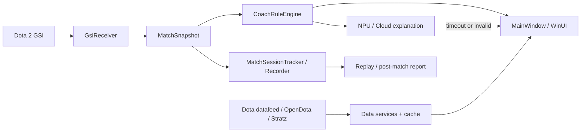

# 神盾教练架构评审与演进路线

评审日期：2026-08-13  
评审对象：当前工作区，不把 `docs/OPERATION_LOG.md` 中的历史结构当成现状。

## 1. 结论

当前架构适合原型和单机 MVP：唯一 WinUI 产品入口清楚，GSI 接收、确定性规则、AI 解释和降级链路方向正确，核心逻辑可以被离线工具复用。它的主要风险不是“项目数量太少”，而是表示层和组合根混在 `MainWindow`，导致 UI、网络和服务生命周期互相放大变更风险。

不建议立刻恢复独立 Core DLL 或进行全量 MVVM 重写。更合理的顺序是先建立可回归的真实数据样本和页面状态契约，再逐页拆分 `MainWindow`；否则大规模重构只会改变文件位置，不能证明提醒更准、降级更稳或界面更可用。

## 2. 当前数据流与边界



合理的因果机制：

- GSI 先被校验、归一化和去重，再进入规则与记录，避免原始字段漂移直接污染 UI。
- 规则决定是否提醒，AI 只解释；模型超时回退规则原文，因此模型故障不会切断实时链路。
- 缓存、重试、低样本抑制和来源标识降低外部 API 波动造成的错误确定性。
- `Core` 不依赖 WinUI，冒烟与回放工具可直接链接源码进行离线验证。

## 3. 架构评分

| 维度 | 判断 | 原因 |
|---|---|---|
| 产品边界 | 合理 | 单一 Windows 产品入口，合规边界明确 |
| 数据与规则链 | 合理 | 输入校验、确定性规则、AI 解释和回退顺序正确 |
| 可测试性 | 部分合理 | 有 131 项冒烟断言和回放工具，但缺少常规单元测试项目、UI 自动化和固定真实比赛基准集 |
| 表示层 | 已大幅改善 | `HeroesPage`、`ItemCatalogPage` 与 `CoachPage` 已完成独立 MVVM 页面拆分，`MainWindow` 回归导航与全局生命周期协调宿主 |
| 模型组织 | 需要改善 | API DTO、转换器、统计与展示模型可继续按领域解耦 |
| 数据服务 | 合理 | 官方 Datafeed / OpenDota 查询、多级缓存、重试降级与白名单过滤已稳定收敛 |
| 依赖管理 | 合理 | 各页面 ViewModel 拥有独立生命周期与状态管理 |
| 发布成熟度 | 已基本闭环 | 已实现 `神盾教练.exe` 独立发布产物与 `package-release.ps1` 一键免安装打包 |

行数不是问题本身。因果是：一个类同时拥有多类状态和副作用，修改其中一条路径时难以只验证局部；最终表现为回归范围扩大、异步取消遗漏和 UI 状态组合不可穷举。

## 4. 关键问题与改善方案

### P0：先建立产品可信度基线

当前最大不确定性不是代码组织，而是自动测试无法证明真实 Dota 2、外部 API、桌面交互和模型质量。

1. 从脱敏 NDJSON 选取固定回放样本，为每条规则标注预期触发时间、允许误差和不应触发区间。
2. 为 datafeed、OpenDota 和 Stratz 保存不含身份信息的 fixture，验证字段缺失、类型变化、429 和损坏缓存。
3. 建 UI 状态矩阵：每页至少覆盖 loading、empty、error、degraded、ready，并记录键盘、主题、窄窗和 DPI 结果。
4. 把“131 项断言通过”视为本地逻辑基线，不等同于真实对局通过。

### P1：按用户路径拆分 MainWindow（已基本完成核心页面）

目标不是追求层数，而是让一条变更只影响一条用户路径。

```text
MainWindow / App
  -> 只负责导航、窗口生命周期、首次启动门控与依赖装配
Views
  -> HeroesPage, ItemCatalogPage, CoachPage
ViewModels
  -> 页面状态、取消、加载、筛选与命令
Services
  -> 外部 I/O 与后端适配（DotaDataService, CloudCoachService, NpuGenAiCoachService）
Core
  -> 不依赖 WinUI 的确定性领域逻辑（GSI, Rules, Replay, MatchAnalysis）
```

拆分进展：
- ✅ `HeroesPage` + `HeroesViewModel`：四属性分类、防抖搜索、Dota 2 1级属性精确计算、天赋树、阿哈利姆升级与克制对阵。
- ✅ `ItemCatalogPage` + `ItemCatalogViewModel`：官网式分组网格、56x42 悬浮卡、商店/中立分类、多选 Chip、防抖搜索与详情懒加载。
- ✅ `CoachPage` + `CoachViewModel`：GSI 状态监听、比分昼夜概览、带证据提醒流、阵容出装推荐。
- ⏳ 赛后分析（Analysis）与高级设置（Settings）页面可按需继续组件化。

### P1：收紧依赖与异步生命周期

- 在 `App` 或单一 `ApplicationServices` 组合根创建长生命周期服务，明确谁负责 `Dispose/IAsyncDispose`。
- ViewModel 依赖最小接口，如资料查询、教练状态流和报告仓库；接口只在确实需要替换或隔离副作用时创建。
- 页面切换取消页面级请求，窗口关闭取消应用级请求。请求 ID 只能防止旧结果覆盖，不能代替真正取消网络和计算。
- UI 更新集中通过 `DispatcherQueue`，后台服务不得直接操作控件。

### P2：按变化原因拆模型和数据服务

- 将 `DotaModels.cs` 逐步拆为 `HeroModels`、`ItemModels`、`CatalogModels`、`JsonConverters` 和展示模型；不是按“一类一文件”机械拆分。
- 将 `DotaDataService` 拆成上游客户端、缓存仓库和领域聚合器。这样 API schema、缓存策略和页面查询可以独立测试。
- 把 patch、来源、获取时间和数据质量作为返回结果的一部分，而不是散落的 UI 文本；UI 才能统一呈现 degraded 状态。

### P2：修正工具复用方式

`GsiSmoke` 和 `GsiReplay` 目前通过 `<Compile Include=...>` 链接 Core 源码。短期可保留，因为它让 Core 继续无 WinUI 依赖；但需要一个自动检查保证新 Core 文件被通配符包含且没有引入 WinUI-only 依赖。

只有当以下任一条件出现时，再将 Core 恢复为独立项目：

- 工具与应用需要不同发布节奏；
- Core 需要被第三个产品稳定引用；
- 链接源码导致编译常量、资源或依赖行为分叉；
- 测试隔离需要明确程序集边界。

## 5. UI 架构与设计契约

UI 的核心不是“更像游戏”，而是让用户在数据不完整和实时变化时仍能判断当前状态与下一步动作。

| 目标 | 机制 | 验收 |
|---|---|---|
| 密集但可扫描 | 稳定区段、紧凑信息行、少量语义强调 | 10 秒内能定位来源、时间、状态和主操作 |
| 主题可靠 | `ThemeResource` + 系统语义色 | Light/Dark/HighContrast 无不可读文本 |
| 响应式 | `VisualStateManager` + 自适应网格 | 640/1024/1440px 与 100/150/200% DPI 无遮挡 |
| 状态完整 | loading/empty/error/degraded/ready 显式建模 | 无空白页；错误给出对应恢复动作 |
| 可访问 | 键盘顺序、可见焦点、AutomationProperties | 仅键盘可完成主路径，状态不只靠颜色 |
| 上下文保持 | 页面状态归 ViewModel，详情不重建列表 | 返回后保留滚动、筛选与选择 |

视觉风格保持中国用户可读的 Dota 资料面板：深浅主题均可用，琥珀金仅作强调，胜负/警告不依赖红绿二色，正文不使用展示字体。禁止营销式 Hero、卡片套卡片、装饰性光斑、持续动效和无依据的赛博视觉元素。

完整 UI 研发 prompt 位于仓库根目录 `AGENTS.md` 和 `docs/AI_AGENT_PROMPT_TEMPLATES.md`。

## 6. 演进里程碑

| 里程碑 | 状态 | 完成定义 |
|---|:---:|---|
| M1 可信度基线 | ✅ 已完成 | 固定 GSI 回放、API fixture、规则触发基准、131 项冒烟测试进入仓库 |
| M2 页面边界 | ✅ 已完成 | HeroesPage / ItemCatalogPage 拆出，行为完全一致，数据与状态收敛至 ViewModel |
| M3 实时链路 | ✅ 已完成 | CoachPage 状态独立，GSI 接收、断线、重连与 AI 回退链路闭环 |
| M4 发布门槛 | 🟡 进行中 | `神盾教练.exe` 独立发布完成；真机、多 DPI、联网降级与隐私清单持续验证 |

架构改善的衡量指标不是文件变多，而是：一次页面改动所需回归范围缩小；服务可用 fixture 替换；异步任务有明确所有者；每个用户可见状态都有可重复验证证据。
