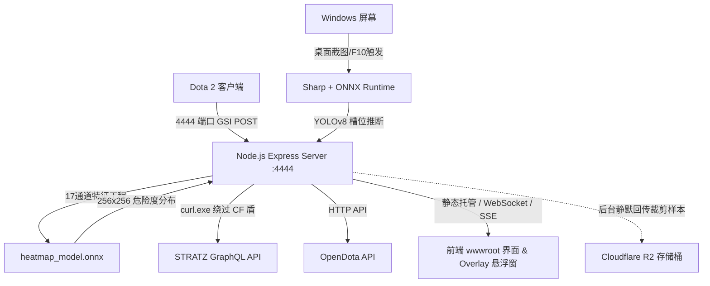

# DOTA2 导师助手 (Mentor Pack) 全量功能解构与研发参考文档

本文档对前序工程原型归档目录 `dota2-mentor-pack-202608041148` 进行了深度剖析与功能解构，旨在为神盾教练（Aegis Coach，Wails v3 + Go + Vue 3 架构）的技术迭代、算法复用与功能迁移提供权威参考。

---

## 目录
1. [系统整体架构与运行时环境](#一系统整体架构与运行时环境)
2. [后端服务入口与生命周期 (server.js & shared.js)](#二后端服务入口与生命周期)
3. [视觉识别与 ONNX 推理矩阵 (YOLOv8 & CNN)](#三视觉识别与-onnx-推理矩阵)
4. [小地图 17 通道安全热图算法 (heatmap.js)](#四小地图-17-通道安全热图算法)
5. [DOTA2 官方 GSI 协议与局内事件判定 (routes/gsi.js)](#五dota2-官方-gsi-协议与局内事件判定)
6. [大数据 API 与对抗克制引擎 (STRATZ & OpenDota)](#六大数据-api-与对抗克制引擎)
7. [电竞黑话词典与跨语言聊天翻译 (routes/translate.js)](#七电竞黑话词典与跨语言聊天翻译)
8. [战术知识库与播报编辑器 (Vault & Broadcast)](#八战术知识库与播报编辑器)
9. [离线数据闭环与静默收集 (r2_upload.js)](#九离线数据闭环与静默收集)
10. [前端模块化体系 (wwwroot/js)](#十前端模块化体系)
11. [与当前神盾教练架构映射与演进指引](#十一与当前神盾教练架构映射与演进指引)

---

## 一、系统整体架构与运行时环境

### 1. 软件组成拓扑
- **客户端外壳**：Electron 桌面应用（`DOTA2 AI导师助手.exe`，打包核心位于 `resources/app.asar`），使用 `elevate.exe` 提供 Windows UAC 提权执行能力。
- **内嵌 Node.js 环境**：`nodejs/` 携带轻量级 Node.js 运行时与包管理工具（npm, corepack, pnpm），无需用户本机预装 Node.js。
- **后台服务层**：位于 `resources/server/`，基于 Express 4.18 + Sharp 0.35 + ONNX Runtime Node 1.26。
- **前端展示层**：位于 `resources/server/wwwroot/`，基于纯原生 ES6 模块化方案开发，由 Express 静态托管并与游戏内悬浮层通信。

### 2. 进程协作模型


---

## 二、后端服务入口与生命周期

### 1. 模块化原则与入口规范 (`server.js`)
- **原则**：`server.js` 仅作为模块加载器与路由装配总线，严禁堆砌具体业务实现。
- **全局共享状态单例 (`shared.js`)**：
  - `gsiState`：当前 GSI 快照上下文；
  - `gsiLastUpdate` 与 `gsiUpdateCount`：心跳监控与数据帧计数；
  - `inference` / `yoloInference`：ONNX 视觉模型实例单例；
  - `heatmap`：小地图安全模型实例；
  - `overlayState`：游戏内置顶悬浮窗坐标与内容状态；
  - `STRATZ_API_TOKEN`：STRATZ 访问凭据。

### 2. GSI 核心事件流预处理 (`server.js` 拦截)
在快照流入路由层之前，`server.js` 内嵌了轻量事件差分处理器，基于相邻两帧数据判定关键游戏事件：
- **击杀/连杀/多杀判定**：
  - 维护 10 秒时间窗口内的击杀时间戳数组；
  - 10 秒内连续击杀判定：2杀（双杀）、3杀（三杀）、4杀（四杀）、5杀（暴走）。
- **阵亡判定**：`deaths > prevDeaths` 触发 `_deathEvent`。
- **等级提升判定**：`level > prevLevel` 触发 `_levelUpEvent`。
- **肉山刷新与坑位追踪**：
  - 监测 `roshan_timer` 状态跳变（从 0 变正数代表肉山刚被击杀；从正数变 0 代表肉山已复活）；
  - `_roshanActivePit = _roshanKillCount % 2`：精准追踪肉山在天辉/夜魇坑位的交替规律。

---

## 三、视觉识别与 ONNX 推理矩阵

项目包含两大视觉推理路径：基于 YOLOv8 的全画面目标检测，与基于 CNN 的传统裁剪槽位分类。

### 1. YOLOv8 英雄槽位识别 (`inference_yolo.js`)
- **模型文件**：`python/yolov8n_hero.onnx`（13.6MB）
- **分类标签**：`python/hero_classes.txt`（涵盖 120+ Dota2 英雄）
- **图像预处理 Pipeline**：
  1. 使用 `sharp` 提取屏幕截图的宽高元数据；
  2. Letterbox 算法：按原图长宽比等比缩放至最大边不超过 640；
  3. 创建 640×640 灰色（灰度值 114）画布，将缩放后的图像居中粘贴；
  4. 像素归一化并完成 HWC $\rightarrow$ CHW 转换，生成 `[1, 3, 640, 640]` 的 `float32` Tensor。
- **后处理与阵营槽位分配**：
  - 解析 YOLO 输出 Tensor `[1, 4 + numClasses, numDetections]`；
  - 设定置信度阈值 `CONF_THRESH = 0.06`，IOU 阈值 `IOU_THRESH = 0.45`；
  - 坐标逆映射回原始屏幕尺寸；
  - **几何空间槽位映射**：根据横坐标中线将检测到的英雄包围盒拆分为天辉（左侧 5 个槽位）与夜魇（右侧 5 个槽位），按水平从左至右排序并填充输出。

### 2. 槽位手动纠错与校准覆盖 (`slot-overrides.json`)
- 支持在 `routes/recognize.js` 中通过 `/recognize/save-slots` 接口动态保存分辨率覆盖配置（如 `2560x1440`、`1920x1080`），实现用户手动微调后的即时持久化。

---

## 四、小地图 17 通道安全热图算法

小地图安全预测是该项目的核心特色功能，定义于 `heatmap.js`，通过空间特征工程将战场局势编码为 17 通道张量并输入轻量卷积神经网络。

### 1. 17 通道特征工程规格
| 通道索引 | 特征通道名称 | 生成机制与数学模型 |
| :--- | :--- | :--- |
| **0 ~ 1** | 天辉/夜魇英雄热度 | 以当前存活英雄的世界坐标为中心，叠加二维高斯分布核 |
| **2** | 存活建筑物与防御塔 | 防御塔位置注入高斯正响应（友方安全/敌方威胁） |
| **3** | 全体英雄联合分布 | 敌我双方全体英雄的密度投影 |
| **4** | 比赛时钟归一化通道 | 全平面常量填充：`clockTime / 3600.0` |
| **5 ~ 10** | 6 权威空间地标欧氏距离 | 天辉水泉、夜魇水泉、天辉传送门、夜魇传送门、下河道神符、上河道神符的欧氏空间距离场归一化 |
| **11 ~ 13** | 3 兵线路径软距离场 | 优势路、中路、劣势路分段折线距离高斯衰减：$e^{-\frac{d^2}{2\sigma^2}}$（$\sigma = 400$ 码） |
| **14** | 河道中心线软距离场 | 沿双臂河道分段骨架线的高斯距离衰减（$\sigma = 600$ 码） |
| **15** | 兵线与建筑密集度惩罚 | 用于过滤过于拥挤的狭窄危险地形 |
| **16** | 战术区域离散标识 | 0: 友方野区, 1: 敌方野区, 2: 河道中立区, 3: 友方高地, 4: 敌方高地 |

### 2. 模型输入输出契约
- **输入 Tensor**：`[1, 17, 256, 256]`，基于 DOTA2 世界坐标系范围 $[-8200, +8200]$ 投影至 $256 \times 256$ 网格。
- **输出 Tensor**：`[1, 1, 256, 256]`，各像素点值在 $[0.0, 1.0]$ 区间，代表该区域的绝对危险度，前端据此渲染红绿安全着色层。

### 3. 权威地理锚点字典 (`map_anchors_world.json`)
由校准工具导出，精确包含 7.41 版本所有要素坐标：
- 22 座防御塔绝对坐标与所属阵营；
- 5 大神符生成点世界坐标；
- 两大肉山坑位（西北河道与东南河道）；
- 莲花池（Lotus Pond）与经验神龛（Wisdom Shrine）；
- 双方高地 16 个凸包边界点。

---

## 五、DOTA2 官方 GSI 协议与局内事件判定

位于 `routes/gsi.js`，严格遵守 Valve Game State Integration 规范。

### 1. 核心端点契约
- `POST /gsi`：由 DOTA2 引擎主动推送 JSON 实体，端口为 4444。
- `GET /gsi`：供前端轮询，包含 15 秒心跳安全看门狗：
  ```javascript
  const GSI_TIMEOUT_MS = 15000;
  const isStale = !shared.gsiLastUpdate || (Date.now() - shared.gsiLastUpdate > GSI_TIMEOUT_MS);
  if (!state || isStale) {
    if (state) { shared.gsiState = null; }
    return res.json({ connected: false, matchId: '0' });
  }
  ```
  *防呆机制*：超过 15 秒无推送自动清空状态并断开连接，避免游戏退出后残留假状态或产生误报警。

### 2. 状态清洗与扩展字段
在后端自动将原始 GSI 解析为开箱即用的扩展字段：
- `_gpm` / `_xpm`：自动从 `player` 或 `hero` 提取；
- `_selfCn`：内置 120+ 英雄英文 ID 转中文常数映射表；
- `_isTurbo`：根据时钟速率判定是否为加速模式；
- `_roshanActivePit`：通过击杀次数奇偶性指示当前活跃肉山坑。

---

## 六、大数据 API 与对抗克制引擎

位于 `routes/stratz.js` 与 `routes/mentor.js`。

### 1. STRATZ GraphQL 绕过 Cloudflare 盾方案
- **痛点**：Node.js 原生 `fetch` 或 `https.request` 产生的 TLS/JA3 指纹会被 Cloudflare 拦截并返回 403 Challenge 阻断请求。
- **方案**：借助 Windows 10 1803+ 内置的 `curl.exe` 作为子进程代理发起请求：
  - 构造包含合法浏览器 User-Agent、Origin 与 Referer 的 Header 头；
  - 将 GraphQL Query 写入临时文件，通过 `--data-binary @temp.json` 经 `curl.exe` 执行；
  - 零侵入解决 TLS 指纹风控问题。

### 2. 关键对位克制数据查询
- **分路对位胜率 (`laneOutcome`)**：
  ```graphql
  query LaneOutcome($heroId: Short!, $position: MatchPlayerPositionType!) {
    heroStats {
      laneOutcome(heroId: $heroId, isWith: false, positionIds: [$position]) {
        heroId1 heroId2 position matchCount winCount lossCount
      }
    }
  }
  ```
  通过指定位置（如 `POSITION_1` 至 `POSITION_5`），获取英雄在对线期的直接对位净胜率与胜场数，比全局综合胜率更能精准指导对线策略。
- **BP 敌方近期绝活扫描 (`/bp/scan-enemies`)**：
  并发查询敌方 5 名玩家近 20 场 OpenDota 记录，统计各玩家近况出场率最高的前 3 名英雄，为首轮 Ban 人提供数据支撑。

---

## 七、电竞黑话词典与跨语言聊天翻译

位于 `routes/translate.js`，解决东南亚服/国际服队友沟通障碍。

### 1. 黑话缩写词典 (`ABBR_CN`)
内置上百条常用电竞缩写映射，涵盖日常沟通、战术指令与装备名称：
- 战术指令：`bkb` $\rightarrow$ 黑皇杖，`smoke` / `开5` $\rightarrow$ 诡计之雾，`rosh` $\rightarrow$ 肉山，`rax` $\rightarrow$ 兵营，`bb` $\rightarrow$ 买活；
- 状态沟通：`oom` / `no mana` $\rightarrow$ 没蓝，`cd` $\rightarrow$ 冷却，`care` $\rightarrow$ 小心，`ss` / `mia` $\rightarrow$ 英雄消失；
- 友好与情绪用语：`glhf` $\rightarrow$ 好运玩得开心，`ty` / `thx` $\rightarrow$ 谢谢，`mb` $\rightarrow$ 我的错。

### 2. 智能短语转换与机器翻译流水线
1. 输入检测：基于正则表达式 `/[一-鿿]/` 判定输入是否包含中文；
2. 中文输入时：优先在内置常用战术短语库（`CN_DOTA2`）中快速匹配英文对等词（如“开雾抓人” $\rightarrow$ `smoke gank`）；
3. 英文输入时：先展开黑话缩写（如 `pls bkb and rosh` $\rightarrow$ `请 黑皇杖 并且 肉山`），若存在无法转换的整句，则走 MyMemory 翻译 API 兜底。

---

## 八、战术知识库与播报编辑器

### 1. 基于 Markdown 的战术知识库 (`routes/vault.js`)
- 仿 Obsidian 目录结构存放战术笔记（`对线/优势劣势/`、`语音播报/`、`英雄/`）；
- 解析特定正则提取英雄字段：`- **强势期**: 15min` $\rightarrow$ 自动归类为前期/中期/后期英雄；
- **阵容时机评级算法**：
  - 统计天辉与夜魇 5 名英雄的强势期分布；
  - 判定标准：前期英雄 $\ge 3$ 判定为“前期推进阵容”；中期英雄 $\ge 3$ 判定为“中期打团阵容”；后期核心 $\ge 2$ 判定为“后期大核阵容”。

### 2. 播报文案编辑器 (`routes/broadcast.js`)
- 提供针对 `broadcast-config.json` 的 RESTful CRUD 接口；
- 允许用户为神符刷新、买活告警、关键技能冷却等战术事件自定义触发提示文本与时间偏移。

---

## 九、离线数据闭环与静默收集

位于 `r2_upload.js`，用于构建数据飞轮以持续优化端侧模型。

### 1. 动态云端配置机制
- 启动时从 Cloudflare Pages 静态文本读取上传配置（`r2_config.txt`）；
- 具备本地 7 天缓存穿透机制，离线或断网时静默跳过，严禁对用户弹出任何网络报错弹窗。

### 2. 样本裁剪与异步回传
- 在对局关键帧捕获小地图区域并压缩为轻量格式；
- 携带时间戳与前缀异步 POST 至 Cloudflare Workers 端点落盘存储，用于后续模型增量微调。

---

## 十、前端模块化体系

位于 `resources/server/wwwroot/js/`，基于纯原生 JavaScript 架构，高内聚低耦合：

| 模块文件 | 承担核心职责 |
| :--- | :--- |
| `counter-engine.js` | 英雄克制计算中枢，维护克制矩阵与协同关系 |
| `item-recommender.js` | 局内动态出装推荐，根据敌方英雄与对局阶段推荐克制装 |
| `enemy-team.js` | 敌方 5 名英雄技能威胁分析与团战开团点警示 |
| `my-hero-dashboard.js` | 己方实时 HUD：生命/魔法/金币/KDA/正反补/装备栏同步 |
| `screenshot-recognizer.js` | 截屏请求调度、热键响应与槽位渲染反馈 |
| `overlay-bridge.js` | 与置顶小窗进行数据同步与位置持久化 |
| `pet.js` | 桌面动态助手/电子桌宠互动逻辑与状态帧动画 |

---

## 十一、与当前神盾教练架构映射与演进指引

神盾教练已从前序原型的 Electron + Node.js 架构全面升级为 **Wails v3 + Go 1.27 + Vue 3 (Pinia + Tailwind CSS)**，两代技术方案的关键映射关系如下：

| 功能维度 | 原型方案 (`dota2-mentor-pack`) | 神盾教练当前方案 (`Aegis Coach`) | 优势与演进收益 |
| :--- | :--- | :--- | :--- |
| **客户端外壳** | Electron (Chromium + Node.js，包体 120MB+) | Wails v3 + WebView2 (Go 原生编译，包体 15MB 左右) | 内存占用降低 80%，启动秒开，彻底告别 Electron 白屏卡顿 |
| **GSI 服务监听** | Node.js Express 接收 4444 端口 POST | Go 原生 `net/http` 高性能单消费者监听 | 10Hz GSI 快照处理时延低于 0.1ms，彻底杜绝 GC 卡顿 |
| **IPC 通信** | HTTP REST 轮询 + WebSocket 桥接 | Wails v3 强类型类型安全绑定 (`frontend/bindings/`) | 零序列化损耗，完全规避端口冲突风险 |
| **视觉模型推理** | ONNX Runtime Node (Sharp 预处理) | Go 端侧调用 / WebAssembly ONNX Runtime | 保持轻量化交付，不依赖臃肿的 Python 或原生 C++ 动态库 |
| **TTS 语音合成** | Node.js edge-tts (依赖在线网络) | 内置原生离线 MeloTTS 引擎 (`github.com/getcharzp/go-speech`) | 纯本地离线秒级发音，零网络依赖，支持专业电竞词典矫正 |
| **UI 页面设计** | 传统 HTML/CSS + 原生 JS 脚本拼接 | Vue 3 + Tailwind CSS + 严格 DOM 极简铁律 | 无冗余副标题，单页面置顶顶格，响应式战术大盘 |
| **合规与零伪造** | 前端存在 Mock 调试数据 | 严格遵循开工红线：无真实对局时严格空态守卫 | 绝不伪造敌法师或虚假战局，保障选手比赛合规与可信赖度 |

---

> [!TIP]
> **参考与迁移指南**：
> 1. 若需扩展小地图安全热图，可直接复用 `heatmap.js` 中的 17 通道特征工程与 `python/map_anchors_world.json` 权威地理要素；
> 2. 若需增强国际服跨语言翻译，可直接迁移 `routes/translate.js` 中的电竞黑话词典矩阵（`ABBR_CN` 与 `CN_DOTA2`）；
> 3. 若需补充选手近况绝活扫描，可参考 `routes/stratz.js` 中的分路对抗与 BP 扫描接口。
