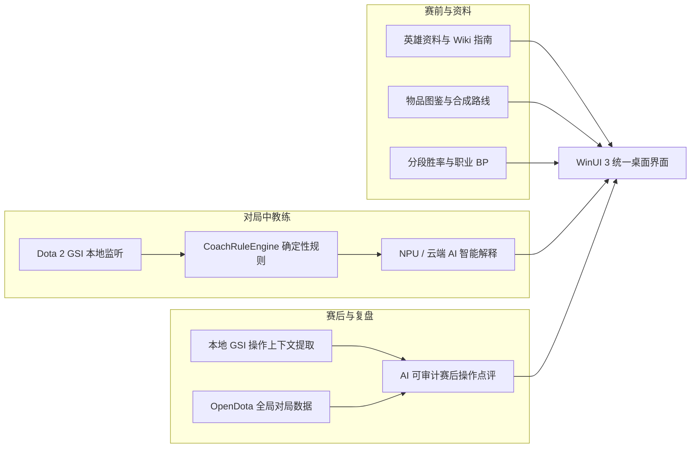
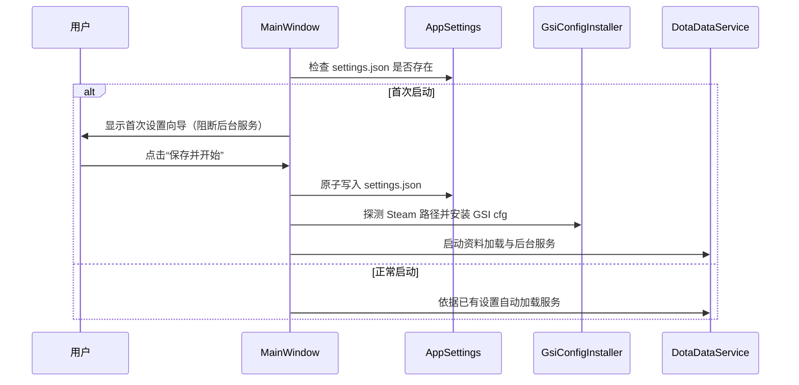

# 神盾教练项目完整文档

文档版本：2026-09-07
产品范围：Windows PC 原生桌面应用（WinUI 3 / C# / .NET 10 LTS / Windows App SDK）
当前阶段：资料库与机制查询 + GSI 实时教练闭环 + 本地/API 赛后复盘分析

> **说明**：完成度是工程估计，不是测试覆盖率。已编译通过不等于真实验收完成；涉及 Steam、Dota 2、在线 API、NPU 推理和桌面 UI 交互的功能仍需以真实环境验收为准。

---

## 1. 项目定位与核心能力

神盾教练是一个面向 Windows PC 用户的 Dota 2 深度资料、实时辅助与赛后教练工具。项目由三条核心能力链组成：



1. **赛前资料与机制查询**：覆盖全部英雄、技能（含先天与阿哈利姆升级）、Dota 2 风格天赋树、分段出装胜率、克制关系以及官网式物品分类与合成路线。
2. **对局中教练（GSI 确定性闭环）**：本地监听 Dota 2 Game State Integration，由规则引擎先产生带证据的确定性提醒（低血/低魔、大招转好、阵亡、控制锁定、买活窗口、昼夜/建筑/肉山事件等），AI 仅负责可选的语言改写，故障时秒级降级规则原文。
3. **赛后复盘与操作点评**：本地 GSI 回放提供阵亡前秒级技能/道具/决策上下文，OpenDota 公开接口补充整局阵容、团战、视野与经济曲线，模型按游戏时间输出操作点评。

---

## 2. 合规与技术边界

- **非外挂原则**：神盾教练严格遵守 Valve 反作弊（VAC）规则。**不读取**游戏进程内存，**不注入** DLL，**不 Hook** DirectX/OpenGL，**不模拟**鼠标键盘输入，**不执行**任何自动化施法/购买/移动操作。
- **输入数据源**：实时数据仅来自于 Dota 2 官方提供的 Game State Integration（本机 HTTP POST 到 `127.0.0.1`）。
- **视野与敌方边界**：GSI 只提供本玩家第一视角及部分全局比赛状态，不包含未探索区域敌方位置、敌方技能冷却或战争迷雾后数据；规则引擎与 AI 严格基于可证明的事实进行提醒，绝不编造或推测作弊信息。
- **隐私与凭据安全**：Steam Token、GSI Token 和完整 Steam ID 绝不进入日志、赛后报告或模型 Prompt；外部 API 密钥（OpenAI/Stratz）统一存放在 Windows 凭据保险库（`PasswordVault`），不明文保存在配置文件中。

---

## 3. 首次启动与设置流程

首次安装不存在 `settings.json`。应用启动后受门控保护直接进入“首次设置”模式，在用户点击“保存并开始”成功前：
- 不加载英雄、物品或赛后数据；
- 不访问任何外部在线 API；
- 不探测或启动本地 NPU 推理引擎；
- 不启动 GSI 本地 HTTP 监听。



- **普通设置**：傻瓜化配置（自动配置 Dota 2、AI 解释方式、开局自连、全场英雄追踪、数据目录）。
- **高级设置**：折叠管理（手动指定 Dota 2 `cfg` 路径、云端 API 地址与密钥、本地模型路径、规则阈值与独立冷却时间）。
- **配置持久化**：统一保存至用户 `文档\AegisCoach\settings.json`，原子替换写入。

---

## 4. 系统架构与代码组织

产品采用单 Native 项目架构，视图与逻辑按 MVVM 规范渐进拆分，核心领域逻辑保持无 WinUI 依赖以便于离线工具复用。

```text
native/AegisCoach.Native/
├── Views/                          # XAML 视图层
│   ├── HeroesPage.xaml(.cs)        # 英雄资料库与详情聚合页
│   ├── ItemCatalogPage.xaml(.cs)   # 官网式物品图鉴与悬浮详情页
│   └── CoachPage.xaml(.cs)         # 实时教练与对局面板页
├── ViewModels/                     # 视图模型层（CommunityToolkit.Mvvm）
│   ├── HeroesViewModel.cs          # 英雄加载、搜索防抖、分段胜率、对阵与天赋
│   ├── ItemCatalogViewModel.cs     # 物品分类筛选、多选 Chip、拼音搜索、详情懒加载
│   └── CoachViewModel.cs           # GSI 快照订阅、提醒流管理、阵容出装推荐
├── Themes/                         # XAML 样式与资源字典
│   ├── GameReferenceStyles.xaml    # Dota 2 电竞暗色与浅色自适应画刷、数值芯片样式
│   └── ItemCatalogTheme.xaml       # 物品金币/法力/属性功能色与 56x42 悬浮卡模板
├── Converters/                     # 绑定转换器（布尔、数量、严重度、结果画刷）
├── Models/                         # 展示模型与 API DTO
│   ├── AppSettings.cs              # 应用配置与凭据存取
│   ├── DotaModels.cs               # 英雄/技能/天赋/统计模型与 DotaItemNameTable
│   ├── ItemCatalogModels.cs        # 物品图鉴分类与展示模型
│   └── OfficialCatalogModels.cs    # 官网数据源 DTO
├── Services/                       # 外部 I/O 与 AI 适配
│   ├── DotaDataService.cs          # 官方 Datafeed / OpenDota 查询、缓存与容错
│   ├── CloudCoachService.cs        # OpenAI 兼容云端 API 解释适配器
│   ├── NpuGenAiCoachService.cs     # OpenVINO GenAI 本地 NPU 推理服务
│   ├── LiveMatchHeroService.cs     # 全场英雄在线查询服务
│   └── ImageCacheService.cs        # 图片本地异步缓存服务
├── Core/                           # 纯逻辑领域目录（无 WinUI 依赖，工具共享）
│   ├── Models/GsiModels.cs         # GSI 快照、状态与提醒领域模型
│   ├── Services/GsiReceiver.cs     # 本机 HTTP 监听、Token 校验与心跳断线管理
│   ├── Services/CoachRuleEngine.cs # 相邻快照差分、确定性规则与独立冷却引擎
│   ├── Services/MatchSessionTracker.cs   # 对局会话追踪与快照记录
│   ├── Services/MatchOperationExtractor.cs # 本地 NDJSON 操作记录提取
│   ├── Services/ApiMatchAnalyzer.cs       # OpenDota match details 全局赛后分析
│   └── Services/AtomicFile.cs             # 跨平台原子文件安全替换
└── MainWindow.xaml(.cs)            # 组合根、一级 NavigationView 导航与生命周期协调
```

---

## 5. 核心模块与实现机制

### 5.1 英雄资料与战斗机制计算

1. **英雄数据链路**：
   - 基础列表：OpenDota `/heroStats` 提供属性/分段统计框架，官方 `/datafeed/herolist?language=schinese` 回填中文名称；
   - 英雄详情：官方 `/datafeed/herodata?language=schinese&hero_id={id}` 提供官方背景、属性成长及技能定义；
   - 技能参数解析：根据内部名定位定义，替换官方描述中的 `%param%`、`{s:param}`，支持 `values_float` / `values` 自动归一化。
2. **Dota 2 1 级实际基础属性标准计算**：
   - **初始生命值**：$120 + \text{base\_str} \times 22$
   - **生命恢复**：$\text{base\_health\_regen} + \text{base\_str} \times 0.1$
   - **初始魔法值**：$75 + \text{base\_int} \times 12$
   - **魔法恢复**：$\text{base\_mana\_regen} + \text{base\_int} \times 0.05$
   - **初始总护甲**：$\text{base\_armor} + \text{base\_agi} / 6.0$
   - **初始攻击力**：根据英雄主属性（力量/敏捷/智力增加 1:1 攻击力，全才每点三维增加 0.7 攻击力）累加到基础攻击区间。
3. **先天技能与阿哈利姆升级**：
   - 先天技能依据官方标记自动排在技能栏最左侧；
   - 提取全部神杖（金蓝卡）与魔晶（紫粉卡）效果，若赋予全新技能（`IsGrantedByScepter` / `IsGrantedByShard`）则提取对应独立技能描述；
   - 技能点击采用 `SelectionBorderBrush` 金色描边高亮，并在 XAML 中通过 `MinHeight` 锁定与 `BringIntoViewRequested` 全局拦截，根除切换技能时的视口跳顶与抖动。

### 5.2 官网式物品图鉴系统

1. **分类与网格**：
   - 顶级分类切换「商店物品 / 中立物品」；
   - 子分类 Chip 筛选（消耗品、属性、装备、军备、奥术、辅助、法器、防具、武器、神器、中立 T1-T5）；
   - 网格使用 56x42 标准比例物品格（圆角 4px，悬浮 1.05 倍微缩放 + 金色描边高亮）；
   - 使用 `CurrentItemCatalog` 游戏内置白名单过滤过期物品，内置 `DotaItemNameTable` 官方全量中文名称映射字典，杜绝乱码与未知占位符。
2. **悬浮详情卡（ToolTip 懒加载）**：
   - 顶部：图标、中文名、分类、金币价格（中立品阶）；
   - 属性：绿字属性加成（如 `+10 攻击力`）；
   - 技能：`[主动]` 蓝字 / `[被动]` 金字 + 冷却时间 / 魔法消耗 + 中文效果说明；
   - 合成路线：展示所需小件缩略图及卷轴价格；
   - 背景故事：斜体三级灰字。

### 5.3 GSI 实时教练与 AI 解释层

1. **GSI 接入与确定性规则**：
   - 自动在 Dota 2 目录生成并安装 `gamestate_integration_aegiscoach.cfg`；
   - `GsiReceiver` 本机 HTTP POST 监听（校验 Token、去重、丢包统计与断线检测）；
   - `CoachRuleEngine` 对相邻快照进行差分计算，触发带证据的确定性规则提醒：
     - 生命危急（<30%）、法力耗尽（<20%）；
     - 大招转好 / 关键主动道具就绪；
     - 英雄阵亡 / 买活窗口 / 控制锁定（眩晕/沉默/缠绕）；
     - 资源饱食（满血满蓝仍未消耗资源）；
     - 昼夜交替（4 分钟圣水符 / 6 分钟神符提醒）、防御塔受损、肉山状态变化。
2. **三级智能后端与秒级降级**：
   - **NPU 本地推理（默认推荐）**：OpenVINO GenAI 在 Intel AI Boost 等 NPU 设备上运行 Qwen2.5-1.5B INT4 模型，零 GPU 占用，不抢占 CPU 游戏主核；
   - **云端 OpenAI 兼容 API**：向用户配置的模型发送脱敏证据 envelope，单请求 6 秒超时限频；
   - **规则原文降级**：当模型未配置、加载超时或网络断开时，系统无缝展示规则引擎的确定性提醒，绝不阻塞 GSI 接收。

### 5.4 赛后复盘与对局数据

1. **双数据源互补机制**：
   - **本地 GSI 操作记录（`MatchOperationExtractor`）**：从脱敏 NDJSON 回放中提取阵亡前 5 秒血量轨迹、关键技能/道具是否就绪、买活时机；
   - **OpenDota 比赛详情（`ApiMatchAnalyzer`）**：按 `match_id` 补充双方阵容、团战走势、视野真假眼、分分钟经济曲线与 APM。
2. **操作点评提示词**：
   - 模型只做操作点评（不复述已有数据，按游戏时间指出关键道具/大招该用未用、阵亡前决策、装备节奏、买活选择）；
   - 严格区分事实（Observed Fact）、推断（Inference）与建议（Recommendation），证据不足时明确输出“无法判断”。

---

## 6. 数据源、缓存与本地覆盖

### 6.1 在线数据源与容错

| 数据源 | 用途 | 缓存策略 | 容错与降级机制 |
|---|---|---|---|
| Dota 2 官方 Datafeed | 官方英雄、技能、物品中文定义 | 目录 30min / 详情 12h | 指数退避重试（3 次），断网回退本地过期缓存 |
| OpenDota API | 英雄结构、分段统计、职业 BP | 目录 30min | 结构漂移结构化兼容，低样本（<30）抑制 |
| OpenDota Explorer | 最近 30 天英雄推荐出装胜率 | 缓存 12h | 限制并发，失败时不影响英雄主资料展示 |
| OpenDota Matches | 赛后整场公开战局数据 | 报告永久持久化 | 私人局/未解析对局自动回退本地 GSI 回放 |
| Steam CDN | 英雄横幅、技能与物品图标 | 自动落盘磁盘图片缓存 | 本地 URL 映射，离线自动加载本地已缓存图片 |
| Dota 2 GSI | 本机实时游戏状态流 | 按天滚动 NDJSON | 自动脱敏 Token，独立存储于统一数据目录 |

### 6.2 本地数据目录与文件组织

所有运行时数据统一保存在用户 `文档\AegisCoach\` 目录下：

```text
文档\AegisCoach/
├── settings.json              # 应用主配置（非敏感配置，原子更新）
├── last-error.txt             # 最近一次运行时异常日志
├── cache/                     # 在线数据本地缓存（按目标版本隔离）
│   ├── heroes-cache-v7.41e.json
│   ├── items-cache-v7.41e.json
│   └── hero-details/
├── data/                      # （可选）本地静态数据覆盖层
│   ├── items-official.json            # 官方物品列表覆盖
│   ├── heroes-official.json           # 官方英雄列表覆盖
│   └── items-details-official.json    # 官方物品详情 itemdata 覆盖
├── gsi/                       # 本地 GSI 快照记录（已脱敏）
│   └── snapshots-YYYY-MM-DD.ndjson
├── analysis/                  # 赛后复盘报告持久化
│   └── report-{matchId}.json
├── habits/                    # 本地玩家习惯统计
│   └── player-habits.json
└── models/                    # 本地 AI 推理量化模型
    └── qwen2.5-1.5b-int4-ov/
```

> **本地静态覆盖机制（可选）**：如果用户或开发者在 `文档\AegisCoach\data\` 下手动放置了官网抓取的 JSON 文件（`items-official.json`、`heroes-official.json`、`items-details-official.json`），`DotaDataService` 会将其作为最高优先级的本地覆盖层加载，用于离线环境或定制数据测试。

---

## 7. 质量指标与完成度矩阵

| 功能模块 | 状态 | 完成度 | 说明 |
|---|:---:|:---:|---|
| **WinUI 3 桌面壳** | 已完成 | 95% | NavigationView 稳定导航、深浅色与高对比自适应、Dota 2 电竞暗金风格 |
| **首次启动门控** | 已完成 | 96% | 强制门控，配置保存前阻断一切外部请求与后台服务 |
| **英雄资料与机制** | 已完成 | 96% | 127 位英雄、四属性分类、1 级基础属性公式、天赋树、神杖魔晶、克制网格 |
| **物品图鉴与悬浮卡** | 已完成 | 94% | 官网分类、56x42 物品格、Hover 微缩放、ToolTip 属性/技能/合成/传说懒加载 |
| **GSI 接收与心跳** | 已完成 | 92% | 本机监听、Token 校验、去重、断线检测、脱敏 NDJSON 记录与回放 |
| **实时教练规则引擎** | 已完成 | 88% | 比赛状态、低血/低魔、大招、阵亡、买活、资源、昼夜、建筑、肉山提醒 |
| **实时教练面板** | 已完成 | 86% | 连接状态、比分昼夜、带证据提醒流、全场阵容出装与克制推荐 |
| **AI 智能解释层** | 已完成 | 78% | NPU 本地 INT4、云端 OpenAI 兼容、规则原文秒级回退 |
| **赛后复盘分析** | 已完成 | 76% | 本地 GSI 操作提取 + OpenDota match details 全局战局 + AI 操作点评 |
| **打包与独立分发** | 已完成 | 92% | `神盾教练.exe` 独立发布产物，内置 XAML 编译资源与一键打包脚本 |
| **自动化测试** | 已完成 | 75% | 131 项冒烟与领域逻辑断言（GsiSmoke），支持离线 NDJSON 回放 |

---

## 8. 构建、测试与发布命令

### 8.1 编译与构建

```powershell
# 项目固定使用仓库声明的 .NET 10 SDK 与集中管理的 NuGet 版本
dotnet --version

# 还原并编译整个解决方案
dotnet restore native\AegisCoach.Native.sln -p:Platform=x64
dotnet build native\AegisCoach.Native.sln --configuration Debug --no-restore -p:Platform=x64
```

当前顶级依赖版本集中定义在根目录 `Directory.Packages.props`：

| 依赖 | 版本 | 用途 |
|---|---:|---|
| `CommunityToolkit.Mvvm` | `8.4.2` | WinUI ViewModel、ObservableProperty 与命令 |
| `Microsoft.WindowsAppSDK` | `2.4.0` | WinUI 3 与 Windows App SDK 运行时 |
| `Microsoft.Windows.SDK.BuildTools` | `10.0.28000.2705` | Windows SDK 构建工具 |
| `JYPPX.OpenVINO.CSharp.API` | `3.3.1` | OpenVINO C# API |
| `JYPPX.OpenVINO.GenAI.runtime.win` | `2026.3.1` | Windows OpenVINO GenAI 运行时 |

`global.json` 固定 .NET SDK `10.0.400`；升级 SDK 或顶级依赖时，必须完成 Native 构建、GSI 冒烟测试和发布打包后再提交。

### 8.2 功能冒烟与离线回放测试

```powershell
# 运行 131 项无外部依赖的端到端冒烟测试（验证 GSI、Token、规则、赛后分析与原子替换）
dotnet run --project tools\GsiSmoke\AegisCoach.Smoke.csproj --no-restore

# 离线回放本地历史 GSI 快照（不连 Dota 2，不访问网络）
dotnet run --project tools\GsiReplay\AegisCoach.Replay.csproj -- "$([Environment]::GetFolderPath('MyDocuments'))\AegisCoach\gsi"
```

### 8.3 自动打包发布版（生成免安装 exe）

```powershell
# 执行发布打包脚本
pwsh -NoProfile -File .\tools\package-release.ps1
```

发布产物位于：
- `release/publish/神盾教练.exe` —— 独立可执行程序（双击直接运行）
- `release/AegisCoach-发布版.zip` —— 完整分发压缩包

---

## 9. 关联文档索引

- **架构评审与渐进演进路线**：[docs/ARCHITECTURE_REVIEW.md](ARCHITECTURE_REVIEW.md)
- **启动、浏览与实时链路 AI 性能优化实施规范**：[docs/AI_PERFORMANCE_OPTIMIZATION_PLAN.md](AI_PERFORMANCE_OPTIMIZATION_PLAN.md)
- **AI 运行时与推理设计**：[docs/AI_RUNTIME_DESIGN.md](AI_RUNTIME_DESIGN.md)
- **AI Agent Prompt 模板与输入契约**：[docs/AI_AGENT_PROMPT_TEMPLATES.md](AI_AGENT_PROMPT_TEMPLATES.md)
- **Steam Dota 2 GSI 接入手册与故障排查**：[docs/STEAM_DOTA2_GSI_GUIDE.md](STEAM_DOTA2_GSI_GUIDE.md)
- **画面捕获与视觉分析可行性调研**：[docs/SCREEN_CAPTURE_AI_FEASIBILITY.md](SCREEN_CAPTURE_AI_FEASIBILITY.md)
- **研发 Agent 仓库指令规范**：[AGENTS.md](../AGENTS.md)
- **开发与验证历史日志**：[docs/OPERATION_LOG.md](OPERATION_LOG.md)
