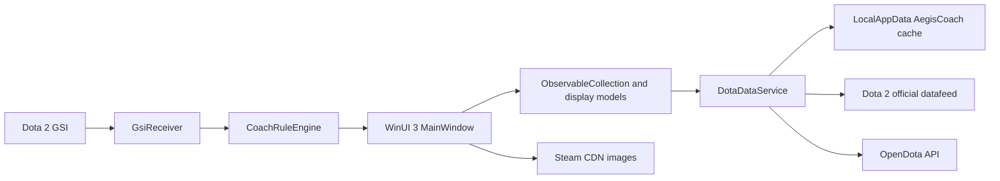
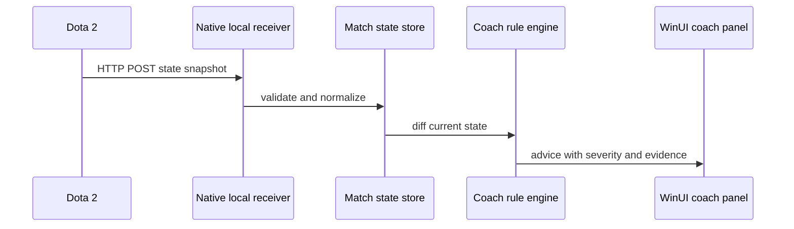

# 神盾教练项目完整文档

文档版本：2026-08-07（当日更新：修复资料参数、当前物品目录、天赋展示、分段出装、页面布局和本地模型解释）  
产品范围：Windows PC 原生桌面应用  
当前阶段：资料库 MVP + GSI 最小闭环（阶段 B 主体完成，阶段 C 已起步）

## 1. 项目定位

神盾教练的目标不是复制一个网页英雄百科，而是逐步形成三个能力：

1. 赛前资料：英雄、技能、天赋、物品和统计信息。
2. 对局中教练：读取 Dota 2 Game State Integration（GSI）状态，基于规则给出低延迟提醒。
3. 赛后分析：收集对局数据，解释关键决策、经济曲线、团战和出装，并由 AI 生成可验证的复盘结论。

当前代码只完成第一项的大部分基础能力。第二、第三项需要新增数据采集、状态建模、规则引擎和分析管线，不能通过继续堆 UI 完成。

## 2. 产品边界

### 2.1 已确定

- 只保留 Windows PC 端。
- 使用 WinUI 3 + C# + .NET 8 + Windows App SDK。
- 不使用 Electron，不使用 Vue，不提供网页端。
- 当前程序是 unpackaged x64 桌面应用，使用自包含 Windows App SDK 运行时。
- WinUI 的本地 HTTP 接收服务仍然可以存在，因为 GSI 使用 HTTP POST；这不是网页产品。

### 2.2 不属于当前 MVP

- 不读取或修改游戏进程内存。
- 不注入 DLL，不做 DirectX Hook。
- 不自动代替玩家操作。
- 不把物品统计称为物品 BP 率。物品没有英雄选人阶段的 BP 事件，当前只显示购买数、胜局数和胜率。
- 不把 Liquipedia 的英文正文直接显示给用户。它只能作为后续知识补充源，并需要处理许可、署名和翻译。

## 3. 技术架构



### 3.1 项目文件

| 文件 | 责任 |
|---|---|
| `native/AegisCoach.Native/MainWindow.xaml` | WinUI 3 左侧导航、英雄页、物品分类页、详情和 Wiki 提示布局 |
| `native/AegisCoach.Native/MainWindow.xaml.cs` | 页面状态、筛选、选择、异步加载和错误提示 |
| `native/AegisCoach.Native/Services/DotaDataService.cs` | HTTP、JSON、缓存、官方接口和 OpenDota 查询 |
| `native/AegisCoach.Native/Models/DotaModels.cs` | API DTO、英雄/物品卡片模型、技能参数替换和统计计算 |
| `native/AegisCoach.Native/App.xaml` | 浅色/深色主题资源、颜色和控件资源 |
| `native/AegisCoach.Native/AegisCoach.Native.csproj` | .NET、WinUI、Windows App SDK 和 x64 构建配置，引用 AegisCoach.Core |
| `native/AegisCoach.Core/AegisCoach.Core.csproj` | net8.0 纯类库（无 WinUI 依赖），承载 GSI 模型与逻辑，便于测试 |
| `native/AegisCoach.Core/Models/GsiModels.cs` | GSI 原始 JSON DTO、归一化 `MatchSnapshot`/`PlayerState`/`HeroState`/`AbilityState`/`ItemState` 与 `CoachAdvice` |
| `native/AegisCoach.Core/Services/GsiReceiver.cs` | 本地 127.0.0.1 TCP 接收器：HTTP POST 解析、token 校验、快照去重、心跳与断线检测 |
| `native/AegisCoach.Core/Services/CoachRuleEngine.cs` | 确定性规则引擎：相邻快照差分、证据字段、每条规则独立冷却 |
| `native/AegisCoach.Core/Services/GsiConfigInstaller.cs` | 生成并安装 `gamestate_integration_aegiscoach.cfg`，支持自动探测/导出/复制 |
| `native/AegisCoach.Core/Services/GsiSnapshotRecorder.cs` | 按日期记录通过校验的 GSI NDJSON 快照，并脱敏 token |
| `native/AegisCoach.Native/Models/AppSettings.cs` | 端口、token、自动启动、手动 cfg 目录等本地设置持久化 |
| `native/AegisCoach.Native/Converters/SeverityToBrushConverter.cs` | 提醒严重级别到主题色画刷的 XAML 转换器 |
| `tools/GsiSmoke/Program.cs` | 无外部依赖的端到端冒烟测试（模拟 Dota 2 POST 快照） |

### 3.2 为什么选择原生 WinUI 3

当前功能是 Windows 桌面资料工具，原生方案有三个直接收益：

- 窗口、主题、缩放、系统字体和高 DPI 行为由 Windows 框架处理。
- C# 可以直接承载后续 GSI 本地服务、规则引擎、文件系统和通知能力。
- 不需要同时维护浏览器渲染层和桌面壳层。

代价也很明确：

- WinUI 3 的生态和跨平台能力弱于 Web 技术。
- 需要处理 Windows App SDK 运行时、x64 发布和安装包。
- 真正的游戏内覆盖层仍需要单独设计，普通 WinUI 窗口不能自动获得 Overwolf 的叠加层生命周期。

这组代价对当前“只做 Windows PC”的目标是可接受的。

## 4. 当前功能和完成度

完成度是工程估计，不是测试覆盖率。已编译不等于已完成，涉及联网和 UI 交互的功能还需要实机验收。

| 模块 | 当前状态 | 完成度 | 说明 |
|---|---:|---:|---|
| WinUI 3 PC 壳 | 已完成 | 90% | 左侧 NavigationView、窗口缩放、基础错误状态和系统主题资源已存在 |
| 英雄目录 | 已完成 | 95% | 约 127 位英雄、缓存命中时重新合并官方中文名、力量/敏捷/智力/全才分类、搜索、排序和可滚动响应式卡片 |
| 英雄图片 | 已完成 | 80% | 大窗口使用横幅图，小卡片切换图标；资源来自 Steam CDN，尚无离线图片包 |
| 英雄技能 | 基本完成 | 90% | 官方中文描述、技能图片、标签、冷却、魔法消耗、天赋、魔晶/神杖和参数替换 |
| 技能参数中文显示 | 基本完成 | 90% | 支持 `%name%`、`{s:name}`、官方 `values_float`/`values`，并归一化大小写和下划线差异 |
| 英雄分段胜率 | 已完成 | 85% | 8 个分段、胜率条、胜率数值和样本量；缺少样本显著性和版本筛选 |
| 英雄职业 BP | 基本完成 | 75% | 使用 `pro_pick + pro_ban` 计算职业样本 BP 占比，不是全体玩家 BP |
| 物品目录 | 已接入并可降级 | 90% | 优先使用官方中文 itemabilities，按官网式商店类别筛选排序，官方 TLS/网络失败时回退 OpenDota constants/items，过滤图纸并支持搜索 |
| 物品详情 | 已接入 | 70% | 价格、说明、传说、备注和统计区域已接入；官方详情不可用时保留基础目录资料 |
| 物品统计 | 可选增强 | 65% | OpenDota Explorer 最近 30 天购买栏位统计；统计失败不再阻断物品目录 |
| 本地缓存 | 已完成基础版 | 80% | 目录、详情和统计缓存按目标版本 v7.41e 隔离；仍缺少原子写入和迁移策略 |
| Wiki 小技巧 | 已实现内置版 | 60% | 详情页显示按英雄整理的机制提示；当前属于编辑内容，不冒充官方或当前版本胜率结论 |
| 数据失败提示 | 基本完成 | 75% | 区分目录失败、官方中文详情失败和统计失败；已增加 OpenDota 物品目录降级，仍缺少重试退避 |
| GSI 接收 | 已实现基础版 | 70% | 本地 127.0.0.1 监听、token 校验、快照去重、心跳与断线检测；有效快照已按日期 NDJSON 落盘，尚无回放工具 |
| 对局状态模型 | 基本完成 | 70% | `MatchSnapshot` 及玩家/英雄/技能/物品子模型已建立，含阶段映射；缺少多英雄视角 |
| 实时教练规则 | 首批规则 | 65% | 比赛开始/结束、低血量、低魔量、大招就绪、阵亡、控制锁定、买活窗口、资源完整；每规则冷却与证据字段 |
| 本地智能解释 | 可选增强 | 40% | LocalCoachService 连接 Ollama，默认 qwen2.5:1.5b；只解释规则事件，超时回退，不阻塞 GSI |
| 游戏内覆盖层 | 未开始 | 0% | 原生窗口、Overwolf 或其他 overlay 方案尚未选型实现 |
| 赛后数据导入 | 未开始 | 0% | 尚未接 OpenDota/STRATZ match details 或 replay 分析 |
| AI 赛后分析 | 未开始 | 0% | 没有特征抽取、证据片段、模型调用和报告存储 |
| 安装包和自动更新 | 未开始 | 10% | 只有可运行的 Debug x64 输出，没有稳定发布渠道 |
| 自动化测试 | 冒烟测试 | 25% | `tools/GsiSmoke` 提供 31 项端到端断言；尚无 API fixture 与 UI 测试 |

按目标能力看：资料库 MVP 约 75%，整个“EchoClip 类产品”约 30%。后一个数字较低是因为实时教练和赛后 AI 才是产品难点，资料页面只是基础设施；GSI 最小闭环落地后略有上升，但规则、overlay 与赛后 AI 仍是主要工作量。

## 5. 已实现功能说明

### 5.1 英雄资料

- 从 OpenDota `heroStats` 获取英雄统计字段。
- 从官方 `herolist` 获取中文名称，覆盖 OpenDota 的英文或不稳定名称。
- 按 `primary_attr` 映射为力量、敏捷、智力、全才四组。
- 以当前可用区域宽度计算列数和卡片宽度。
- 卡片宽度小于阈值时显示英雄小图标，否则显示横幅资源。
- 搜索同时匹配中文名称和内部英文名称。
- 支持按胜率、样本量和名称排序。
- 缓存目录命中时仍尝试请求官方中文英雄列表，避免旧缓存中的 OpenDota 英文名长期覆盖中文名。

### 5.2 技能和天赋

官方英雄详情提供中文描述，OpenDota constants 提供技能 ID 到技能定义的补充关系。显示模型会：

1. 找到英雄的技能 ID。
2. 用 OpenDota 基础定义取得图标、行为和伤害类型。
3. 用官方中文详情取得名称、描述、备注、神杖和魔晶文本。
4. 用 `special_values.values_float` 或 `special_values.values` 替换主描述、魔晶、神杖、物品描述和天赋名称中的参数占位符；数字、字符串和数组统一归一化。
5. 对官方字段和 OpenDota `attrib` 字段做统一键名归一化，再将 `is_percentage=true` 的数值追加 `%`。
6. 将常见标签翻译为中文，例如 Unit Target、Passive、Magical。

如果官方详情和 OpenDota constants 的技能 ID 不一致，技能可能只显示部分条目。这是接口版本漂移风险，不是 UI 问题。

#### Wiki 小技巧

英雄详情中的“实战小技巧”是随程序发布的本地编辑内容，按技能机制整理，用于提示视野、施法顺序、资源管理和团战取舍。它不是官方接口字段，不等于当前版本攻略，也不应被解释为胜率或因果结论。未单独整理的英雄会显示通用的信息边界提示，避免把空白伪装成事实。

### 5.3 英雄胜率和 BP

英雄分段统计使用 OpenDota `heroStats` 中的字段：

- `1_pick` / `1_win` 到 `8_pick` / `8_win`：分段样本和胜局。
- `胜率 = win / pick * 100`。
- “全部分段”是 1 到 8 的样本加总后再计算，不是各段胜率的简单平均。
- 职业 BP 目前按 `pro_pick + pro_ban` 计算总职业操作中的占比。

因此当前 BP 的真实含义是“职业样本中的英雄被选/被禁占比”。它不代表普通玩家天梯 BP，也不代表当前版本的即时趋势。

### 5.4 物品

- 官方列表接口返回的列表字段是 `itemabilities`，不是 `items`。
- 图纸通过内部名称 `item_recipe_` 过滤。
- 官方详情的价格字段是 `item_cost`。
- 物品没有选人阶段 BP 事件，因此不显示 BP 率。
- 购买统计从对局的 `item_0` 到 `item_5` 六个栏位展开，按最近 30 天聚合。
- 物品胜率使用该购买样本所在对局的胜负计算：
  `((player_slot < 128) == radiant_win)` 为胜局。

物品胜率不是“买了物品导致胜利”的因果结论。它只表示携带该物品的样本对局中，胜局占比。

物品展示按“消耗品、属性、装备、辅助、魔法、护甲、武器、神器、中立物品、其他”分类。官方 `itemlist` 是当前目录的主来源；目录进入 UI 前会过滤图纸、信使/共享消耗品和已知下线物品。OpenDota 只作为官方目录不可用时的降级源，并补充合成组件。分类筛选与名称搜索同时生效，分类内按中文名排序；“全部”按官网分类顺序展示，而不是全局字母平铺。

合成路线来自 OpenDota constants 的组件 ID，显示在物品详情中。组件缺失时不猜测路线。

英雄出装来自 OpenDota Explorer 最近 30 天的 `player_matches` 最终物品栏位，按 `matches.avg_rank_tier` 映射到当前选择的分数段，再按出场率排序。它表示该分段样本中最常见的出装集合，不代表真实购买时间或因果胜率推荐；OpenDota 不可用时不显示伪造推荐。

天赋文本先使用官方中文 special_values，再使用 OpenDota attrib；只有一个属性值的特殊天赋才允许单值回退，通用 special_bonus_*_300 类才从 ID 末尾回退。未解析的占位符会被移除，不把 %value% 当成最终展示内容。

### 5.5 GSI 与实时教练（阶段 B/C 已实现部分）

目标数据流已经打通：Dota 2 通过 `gamestate_integration_aegiscoach.cfg` 把状态快照 POST 到本地接收器，接收器归一化为 `MatchSnapshot`，规则引擎对相邻快照做差分，产生带证据的提醒显示在“实时教练”页面。

#### 接收器（`GsiReceiver`）

- 使用 `TcpListener` 监听 `127.0.0.1`，不暴露到公网，也不需要 http.sys URL ACL。
- 每次连接只处理一个 HTTP POST，解析 `Content-Length` 读取正文，始终返回 `200 OK`（避免 Dota 2 反复重试）。
- token 校验：配置了 token 时，快照 `auth.token` 必须匹配，否则忽略并记日志。
- 去重：2 秒内相同正文的快照只算心跳，不重复触发规则。
- 断线检测：默认 8 秒没有收到任何有效正文，连接状态变为“未连接”，恢复后回到“已连接”。
- 事件：`SnapshotReceived`、`ConnectionChanged`、`Log`，由 UI 通过 `DispatcherQueue` 切换到界面线程。

#### 快照记录（`GsiSnapshotRecorder`）

- 仅记录通过 token 校验且成功解析的快照，文件按本地日期写入 `%LOCALAPPDATA%\AegisCoach\gsi\snapshots-YYYY-MM-DD.ndjson`。
- 每行包含 `received_at` 和 `snapshot`，保留原始 GSI 字段，便于后续回放规则。
- `auth.token` 写入前替换为 `[REDACTED]`；写盘失败只记录日志，不影响当前快照进入规则引擎。

#### 配置安装（`GsiConfigInstaller`）

- 生成符合 Valve GSI 规范的 `gamestate_integration_aegiscoach.cfg`（uri、timeout、buffer、throttle、heartbeat、data、auth）。
- 自动探测：扫描 Program Files 下的 Steam 与常见盘符根目录，并解析 `steamapps/libraryfolders.vdf` 登记的其他库路径；兼容新布局 `game/dota/cfg` 与旧布局 `dota/cfg`。
- 手动兜底：UI 支持“选择目录”“导出配置文件”“复制配置”，无法自动定位时可手工放置到 `game/dota/cfg/`。
- 设置项：UI 支持端口、可选 token、手动 cfg 目录和“应用启动时自动监听 GSI”；“打开 cfg 目录”可确认自动探测或手动指定的实际路径。

#### 规则引擎（`CoachRuleEngine`）

当前规则（阈值与冷却为硬编码，`Cooldowns` 字典可注入）：

| 规则 ID | 触发条件 | 严重度 | 冷却 |
|---|---|---|---|
| `game_state` | 比赛阶段变化（开始/结束/选人） | 提示 | 30 秒 |
| `low_health` | 对局中 `hero.health_percent ≤ 25` | 严重 | 15 秒 |
| `low_mana` | 对局中 `hero.mana_percent ≤ 20` 且上限 > 0 | 警告 | 20 秒 |
| `ult_ready` | 大招从冷却变为就绪（`ultimate_state` 或 `ultimate` 标记/`ability_3` 回退） | 提示 | 30 秒 |
| `died` | 从存活变为阵亡 | 严重 | 10 秒 |

每条提醒都保存 `Evidence`（触发字段及取值）和 `Rule` 名，UI 直接展示；提醒列表上限 200 条。规则只读本地 GSI，不读写游戏进程内存，不自动执行任何游戏操作。

## 6. 数据来源和更新机制

### 6.1 官方 Dota 2 数据

| 用途 | 接口 |
|---|---|
| 英雄中文列表 | `https://www.dota2.com/datafeed/herolist?language=schinese` |
| 英雄中文详情和技能 | `https://www.dota2.com/datafeed/herodata?language=schinese&hero_id={id}` |
| 物品中文列表 | `https://www.dota2.com/datafeed/itemlist?language=schinese` |
| 物品中文详情 | `https://www.dota2.com/datafeed/itemdata?language=schinese&item_id={id}` |

官方接口负责当前中文名称、描述、价格、分类字段和官方本地化文本。缓存命中也会重新尝试合并英雄中文列表，但网络完全不可用时只能保留上次缓存或 OpenDota 原始名称。

### 6.2 OpenDota

| 用途 | 接口 |
|---|---|
| 英雄统计 | `https://api.opendota.com/api/heroStats` |
| 英雄技能映射 | `https://api.opendota.com/api/constants/hero_abilities` |
| 技能基础定义 | `https://api.opendota.com/api/constants/abilities` |
| 物品统计 | `https://api.opendota.com/api/explorer?sql=...` |

OpenDota 负责统计和部分结构化补充，不负责最终中文文案。

### 6.3 图片

英雄和技能图片使用 Steam CDN 路径。图片没有随安装包打包，所以网络不可用时文字缓存可能仍可用，但图片可能加载失败。

### 6.4 Liquipedia

Liquipedia 适合补充英雄背景、历史改动、职业赛事和版本知识，但当前没有接入运行时展示。未来接入前需要：

- 使用合规的 API 或授权数据。
- 记录来源和署名。
- 建立英文到中文的人工或审核翻译层。
- 将“事实数据”和“编辑性观点”分开。

### 6.5 缓存

缓存目录：

`%LOCALAPPDATA%\AegisCoach\`

当前文件（v7.41e 目标版本）：

- catalog-v7.41e.json：英雄统计目录。
- hero-{id}-zh-v7.41e.json：单个英雄官方中文详情。
- items-v7.41e.json：官方物品目录和合成路线。
- item-{id}-zh-v7.41e.json：单个物品官方中文详情。
- item-metrics-v7.41e.json：物品统计聚合结果。
- hero-build-{hero_id}-{rank_id}-v7.41e.json：英雄当前分段最近 30 天出装统计。
- settings.json：GSI、自动启动和本地模型 endpoint/model 等设置。
- `last-error.txt`：异常诊断文件，后续应在成功加载后清理。

当前 TTL：

- 目录和统计：30 分钟。
- 英雄、物品中文详情：12 小时。

刷新按钮会清空 JSON 缓存并强制重新请求。官方 datafeed 没有可靠 patch 参数，v7.41e 是目标版本口径，不是接口可证明的版本事实；联网环境仍需复核官方目录。

## 7. 尚未完成的问题

### 7.1 资料库层

1. 给 API 调用增加取消令牌的真实生命周期，窗口关闭时取消请求。
2. 增加 HTTP 重试、指数退避、速率限制和超时分类。
3. 对官方接口字段变化增加 fixture 测试，特别是 `itemabilities`、`item_cost` 和技能参数字段。
4. 增加离线缓存的版本号、原子写入、损坏文件恢复和图片本地缓存。
5. 统计增加版本、模式、分段和时间范围选择。
6. 对低样本率显示“样本不足”，避免把 2 局 100% 当成可靠建议。
7. 物品详情和英雄详情增加加载骨架、局部重试和空状态。
8. 当前版本判断仍以官方目录为准；离线降级黑名单需要随游戏更新重新核对。
8. 处理 Windows 证书链、系统时间、代理和企业 HTTPS 检查导致的官方接口 TLS 失败；应用不得通过关闭证书校验规避该问题。

### 7.2 GSI 和实时教练

目标数据流：



已完成（2026-08-06）：

- 生成/安装/导出/复制 `gamestate_integration_aegiscoach.cfg`，含自动探测 Steam 库路径。
- 本地监听 `127.0.0.1`，不暴露到公网；无 http.sys URL ACL 依赖。
- token 校验、2 秒重复快照去重、8 秒断线检测与心跳维持。
- 建立 `MatchSnapshot`、`PlayerState`、`HeroState`、`AbilityState`、`ItemState` 和阶段映射。
- 首批确定性规则：比赛开始/结束、低血量、低魔量、大招就绪、阵亡；每条规则独立冷却。
- 每条提醒保存证据字段、规则名、比赛 ID 与游戏时间，UI 直接展示。

剩余问题：

- 本地回放：快照已落盘，但尚未提供回放工具，暂时仍不能直接离线重放一场对局。
- 多英雄视角：GSI 只返回“我”的 hero/player，队友/对手状态需要其他数据源。
- 规则阈值与冷却未暴露到设置界面（`Cooldowns` 字典可注入，阈值硬编码）。
- 肉山、塔、符、经济差等规则未实现，需要确认 GSI 中可用的字段。
- 游戏开始/结束、选人阶段的真机行为尚未实机验收。
- 端口冲突、多实例、配置被 Dota 2 重载（改 cfg 需重启游戏）等运维细节未处理。
- 提醒目前只在窗口内展示，没有系统通知或游戏内提示音。

### 7.3 游戏内显示

不借助 Overwolf 也可以实现，但需要自己处理：

- 顶层窗口定位和跟随 Dota 2 窗口。
- 无边框、透明、置顶、点击穿透和 DPI 缩放。
- 全屏独占模式下的兼容性。
- 窗口失焦、游戏切换和多显示器。
- 反作弊与 Valve/Steam 使用政策边界。

Overwolf 的价值是提供游戏识别、overlay 生命周期、分发和权限体系；代价是平台依赖、开发约束和额外审核。当前资料库不需要 Overwolf；进入游戏内 overlay 阶段再做技术选型。

### 7.4 赛后分析和 AI

AI 不是直接把整局 JSON 丢给模型。正确链路应是：

1. 获取 match details、玩家身份和时间线。
2. 提取补刀、经济、经验、视野、死亡前事件、技能命中、物品购买和团战片段。
3. 按时间窗口构造证据片段。
4. 用规则先做可验证评分。
5. 将证据和评分交给模型生成解释、改进建议和置信度。
6. 在报告中保留原始证据、数据时间范围和来源。

需要明确的外部能力：OpenDota/STRATZ 的接口限制、Replay 解析能力、AI API 密钥管理、隐私策略和成本控制。实时教练当前不依赖模型；云端模型、本机 Ollama/llama.cpp 或 ONNX 都只能作为可选解释层，具体部署边界见 `docs/AI_RUNTIME_DESIGN.md`。

### 7.5 AI Agent Prompt 契约

项目已将 AI Agent 的公共提示词、输入证据 envelope、输出结构、拒答策略和评估清单集中维护在 docs/AI_AGENT_PROMPT_TEMPLATES.md。所有未来的赛后分析、实时提醒解释、资料问答、数据质量检查和研发 Agent 都应复用该文档，避免每个调用点自行定义一套规则。

实时教练默认只使用确定性规则。没有模型、模型超时或 JSON 校验失败时，界面回退到规则原文，不影响 GSI 接收。

AI 调用的因果链必须保持为：

原始数据 -> 字段校验 -> 特征提取 -> 证据片段 -> 规则评分 -> Agent 解释 -> 可审计报告

模型不得直接消费未脱敏的原始 GSI 快照。每条输出结论必须绑定 evidence_id 和时间范围；数据缺失、样本不足或来源冲突时必须降级为“无法判断”。模型只解释数据，不执行游戏操作，也不参与任何进程读取、注入、Hook、输入模拟或 VAC 规避行为。

## 8. 推荐实施计划

### 阶段 A：资料库稳定化

- 完成物品页面运行时验收。
- 清理网页源代码和旧缓存诊断文件。
- 增加 API fixture 和统计计算单元测试。
- 增加离线模式、空数据和低样本提示。
- 把数据源、统计周期和版本号显示在设置/关于区域。

### 阶段 B：GSI 最小闭环（主体已完成，2026-08-06）

- [x] 添加 `GsiReceiver` 和本地配置安装器（自动探测/手动选择/导出/复制）。
- [x] 在 WinUI 中显示“连接状态、最近快照时间、当前比赛 ID”。
- [x] 只读取本地 GSI，不做 overlay。
- [x] 用 NDJSON 记录通过校验的原始快照，写盘前脱敏 token；解析错误仍只写应用日志。
- [ ] 提供基于 NDJSON 的规则离线回放工具。

### 阶段 C：第一批实时提醒（已起步）

- [x] 低血量/低魔量。
- [x] 关键技能或大招冷却完成（大招就绪）。
- [ ] 肉山、塔、符和关键时间点。
- [x] 自己死亡后的复盘提示。
- [x] 每条提示加入冷却时间，避免刷屏。
- [ ] 阈值、冷却与规则开关做成设置项。

### 阶段 D：游戏内面板

- 先做独立透明 WinUI 窗口。
- 支持快捷键隐藏、点击穿透和位置保存。
- 用窗口模式和无边框模式测试。
- 再决定是否引入 Overwolf，不提前绑定平台。

### 阶段 E：赛后报告

- 接 match details。
- 做可解释的指标与时间线。
- 先输出固定模板报告，再接 AI。
- AI 只负责解释和归纳，不负责创造统计事实。

### 阶段 F：发布

- MSIX 或可靠的 unpackaged 安装器。
- 运行时依赖检查。
- 自动更新、版本回滚和崩溃日志。
- API 限流、隐私说明、数据来源和许可证页面。

## 9. 验收标准

### 当前资料库 MVP

- 无网络时，已有有效缓存可以打开英雄和已缓存详情。
- 127 位英雄可按四种属性正确分组。
- 窗口缩放时卡片列数和图片尺寸稳定，不发生重叠。
- 英雄技能中的 `%parameter%` 不再原样暴露，已知参数显示实际值。
- 分段胜率显示胜率、条形和样本量，缺失数据显示 `--`。
- 物品列表能从 `itemabilities` 解析，图纸不会作为普通物品展示。
- 物品详情价格来自 `item_cost`，统计明确标注最近 30 天。

### 实时教练版本

已实现并通过冒烟测试（`tools/GsiSmoke`，31 项断言）：

- [x] GSI 断开、恢复有明确状态（8 秒无数据 → 未连接，恢复 → 已连接）。
- [x] 同一条件不会在短时间内重复提醒（每规则独立冷却，2 秒重复快照去重）。
- [x] 每条建议能回溯到具体状态字段和触发规则（`Evidence` + `Rule`）。
- [x] 有效 GSI 快照按日期写入本地 NDJSON，写盘前脱敏 token。
- [x] 不读写游戏进程内存，不自动执行游戏操作（只接收本地 HTTP POST）。

待真机验收（安装 cfg 后进入真实对局）：

- 比赛开始（`GAME_IN_PROGRESS`）与比赛结束（`POST_GAME`）状态切换提示。
- `gamestate_integration_aegiscoach.cfg` 在 Dota 2 启动前生效，URI/token 与接收器一致。
- 选人阶段、策略阶段、游戏内阶段在 UI 中正确显示。

### AI 赛后版本

- 每条 AI 结论都能链接到时间段和原始数据。
- 无数据时明确说“无法判断”，不生成确定性结论。
- 用户可以删除本地比赛记录和 AI 报告。

## 10. 构建与运行

### 环境

- Windows 10 17763 或更高版本，建议 Windows 11。
- Visual Studio，安装 .NET 8 SDK、Windows App SDK 相关组件和 C++ 桌面工具链。
- 当前项目目标框架：`net8.0-windows10.0.19041.0`。
- 当前运行时：`win-x64`。

### 构建

```powershell
dotnet build native\AegisCoach.Native\AegisCoach.Native.csproj --configuration Debug --framework net8.0-windows10.0.19041.0 --runtime win-x64 --no-restore
```

### 测试

```powershell
dotnet run --project tools\GsiSmoke\AegisCoach.Smoke.csproj
```

该冒烟测试无需 Dota 2 与网络：启动接收器、模拟 POST 快照、断言解析/token/去重/断线/规则触发/cfg 安装/快照落盘/token 脱敏。

### 运行

```powershell
Start-Process .\native\AegisCoach.Native\bin\Debug\net8.0-windows10.0.19041.0\win-x64\AegisCoach.Native.exe
```

第一次运行需要网络访问官方 Dota 2 接口、OpenDota API 和 Steam CDN。程序不会把数据写回 Dota 2 安装目录；GSI 配置需要用户主动安装（实时教练页面的“安装配置到 Dota 2”，或导出/复制 `gamestate_integration_aegiscoach.cfg` 到 Dota 2 的 `game/dota/cfg/`，修改后需重启 Dota 2 生效）。程序启动后默认自动监听 `127.0.0.1:4444`，可在设置中修改端口与 token。

## 11. 数据和合规风险

- 官方接口、OpenDota、Steam CDN 和 Liquipedia 的许可与限流要求不同，发布前必须分别确认。
- OpenDota 统计有延迟、样本偏差和接口可用性风险，不应包装为官方实时数据。
- AI 分析需要最小化上传玩家标识和比赛数据；默认优先本地保存和脱敏。
- overlay、GSI 和游戏内信息展示必须遵守 Dota 2、Steam、Valve 以及可能使用的平台政策。

## 12. 结论

现在的系统已经具备两个可运行的能力层：WinUI 资料库（英雄/物品/统计）和 GSI 最小闭环（接收快照 → 状态模型 → 确定性规则 → 界面提醒）。GSI 快照落盘已经补齐，但“能记录”还不等于“能复盘”；下一步的优先顺序是：可见桌面/真机验收 GSI → NDJSON 回放 → 规则可配置与扩充 → 系统通知/游戏内显示 → 赛后分析（阶段 E）。

## 13. 给下一个 AI 的接力说明

本节是给后续接手的 AI 的执行索引，按“先做什么、改哪里、怎么验证、有什么坑”组织。

### 13.1 本次已完成（2026-08-06）

- 新增 `native/AegisCoach.Core`（net8.0 纯类库，无 WinUI 依赖），承载 GSI 全部逻辑：
  - `Models/GsiModels.cs`：原始 JSON DTO + 归一化 `MatchSnapshot` 与子模型 + `CoachAdvice`。
  - `Services/GsiReceiver.cs`：127.0.0.1 TCP 接收器（token 校验、2 秒去重、8 秒断线检测、心跳）。
  - `Services/CoachRuleEngine.cs`：`game_state`/`low_health`/`low_mana`/`ult_ready`/`died` 五条规则，每规则冷却 + 证据字段。
  - `Services/GsiConfigInstaller.cs`：cfg 生成、Steam 库路径探测、安装/导出/复制。
- `native/AegisCoach.Native` 引用 Core；新增“实时教练”页面（连接/对局/我的英雄/提醒列表/GSI 配置/日志）；设置持久化到 `%LOCALAPPDATA%\AegisCoach\settings.json`。
- `tools/GsiSmoke`：31 项端到端断言，`dotnet run --project tools\GsiSmoke\AegisCoach.Smoke.csproj` 直接运行。
- 已验证：原生 `dotnet build` 0 警告 0 错误；冒烟测试 31 项全部通过；应用进程可启动并响应，但当前自动化桌面会话未稳定观测到窗口标题和 `127.0.0.1:4444` 监听，需在可见桌面复核。

### 13.2 下一步优先顺序

1. 真机验收：安装 cfg 后进真实对局，确认阶段切换、英雄字段（`ultimate` 标记、`ability_3` 槽位）、提醒触发与阈值合理性。这是当前最大的不确定性。
2. 快照回放：快照已存到 `%LOCALAPPDATA%\AegisCoach\gsi\`，下一步提供回放工具，才能对规则做离线回归。
3. 规则可配置：把阈值、冷却、开关暴露到设置界面（`CoachRuleEngine` 的 `Cooldowns` 已可注入，阈值需参数化）。
4. 扩充规则：肉山、塔、符、关键时间点、经济差、技能冷却完成（不限于大招）。
5. 通知与 overlay：先做系统通知（`ToastNotification`），再评估透明置顶窗口/Overwolf（阶段 D）。
6. 赛后分析（阶段 E）：接 OpenDota `match details`，先固定模板报告，再接 AI。

### 13.3 改动入口索引

| 想改什么 | 文件 |
|---|---|
| 接收端口/token/断线阈值 | `native/AegisCoach.Core/Services/GsiReceiver.cs` |
| 快照字段或阶段映射 | `native/AegisCoach.Core/Models/GsiModels.cs` |
| 加/改规则、冷却、阈值 | `native/AegisCoach.Core/Services/CoachRuleEngine.cs` |
| cfg 内容或路径探测 | `native/AegisCoach.Core/Services/GsiConfigInstaller.cs` |
| 实时教练页面布局 | `native/AegisCoach.Native/MainWindow.xaml`（`CoachPage`） |
| 页面逻辑/事件 | `native/AegisCoach.Native/MainWindow.xaml.cs`（`SetupCoachPage` 起） |
| 设置持久化 | `native/AegisCoach.Native/Models/AppSettings.cs` |
| 冒烟测试 | `tools/GsiSmoke/Program.cs` |
| Steam Dota 2 GSI 接入手册 | `docs/STEAM_DOTA2_GSI_GUIDE.md` |
| 操作记录 | `docs/OPERATION_LOG.md` |

### 13.4 已知限制与坑

- Steam 路径探测不读注册表，非默认盘符需在 UI 手动指定 cfg 目录。
- 修改 Dota 2 的 cfg 后必须重启 Dota 2 才会重新加载。
- `CoachAdvice` 属性必须是可写（`{ get; set; }`）：WinUI XAML 编译器会为绑定模型生成 setter，`init` 会导致 CS8852（已踩过）。
- WinUI 3 的 `Window` 没有 `Resources`，共用资源必须放 `App.xaml` 的 `ResourceDictionary` 内（已踩过）。
- 沙箱/构建环境：`native\` 目录写入与 `dotnet build/run` 需要提权（本机沙箱限制，不影响最终用户）。
- 规则提醒只在窗口内展示；窗口关闭即停止监听。多实例同时监听同一端口会失败，UI 会提示。
