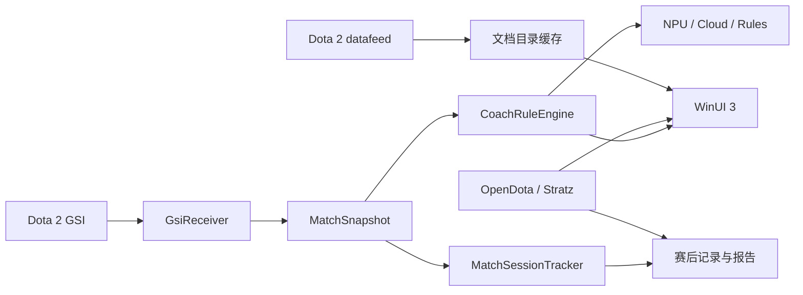

# 神盾教练项目完整文档

文档版本：2026-08-11

产品范围：Windows PC 原生桌面应用

当前阶段：资料库 MVP + GSI 实时教练闭环 + 赛后分析基础版

> 完成度是工程估计，不是测试覆盖率。已编译不等于已完成；涉及 Steam、Dota 2、在线 API、NPU 和 UI 交互的功能仍需要联网或实机验收。

## 1. 项目定位

神盾教练由三条能力链组成：

1. 赛前资料：英雄、技能、天赋、物品、分段统计和对阵资料。
2. 对局中教练：Dota 2 GSI 向本机发送状态，规则引擎先产生可解释提醒，智能后端只负责改写说明。
3. 赛后分析：本地 GSI 回放提供自身逐秒状态，OpenDota 比赛详情补充阵容、团战、视野和经济数据，再生成带证据的复盘。

资料页是后两条能力链的数据基础，但资料页完成不代表产品完成。产品难点仍是实战数据可用性、提醒质量、赛后结论可信度和发布验收。

## 2. 产品边界

- 唯一产品入口是 `native/AegisCoach.Native`，技术栈为 WinUI 3、C#、.NET 8 和 Windows App SDK。
- 解决方案只有一个可启动项目 `AegisCoach.Native`。GSI、规则和赛后逻辑位于项目内的 `native/AegisCoach.Native/Core`，不生成或依赖独立 Core DLL。
- 不读取或修改游戏进程内存，不注入 DLL，不 Hook 图形接口，不模拟输入，不自动操作。
- GSI 只监听 `127.0.0.1`，端口和 Token 是应用内部实现细节，不要求普通用户配置。
- GSI 只提供本玩家视角及部分比赛状态，不包含完整敌方状态、地图坐标、视野、符点和可靠经济差；规则与 AI 不得编造缺失事实。
- OpenDota、Stratz、Steam CDN 和 Dota 2 datafeed 属于外部数据源，其可用性、限流和版本一致性不能由本地编译证明。

## 3. 首次启动与设置

首次安装不存在 `settings.json`。应用启动后直接打开“首次设置”，在“保存并开始”成功前：

- 不加载英雄、物品或赛后数据；
- 不访问在线数据源；
- 不探测或启动 NPU；
- 不启动 GSI 监听。

保存后写入 `文档\AegisCoach\settings.json`，尝试自动定位 Steam 并安装 GSI 配置，然后启动资料和已启用服务。应用不读取、不迁移旧 AppData 配置。

普通设置只表达用户目标：自动配置 Dota 2、自动连接、智能解释方式、全场英雄追踪和数据目录。端口、Token、模型路径、兼容 API 地址、Stratz 密钥、规则阈值和单规则冷却位于内部或高级设置。Cloud/Stratz 密钥使用 Windows 凭据保险库，不写入 `settings.json`。

## 4. 技术架构

本节描述当前已实现结构；目标结构、问题优先级和渐进迁移顺序见 [架构评审与演进路线](ARCHITECTURE_REVIEW.md)。当前保持单一 Native 项目，但不把 `MainWindow` 的大文件形态视为最终设计。



| 文件 | 责任 |
|---|---|
| `native/AegisCoach.Native/MainWindow.xaml` | 导航、资料页、实时教练、赛后分析、首次设置与高级设置 UI |
| `native/AegisCoach.Native/MainWindow.xaml.cs` | 首次启动门控、页面状态、服务生命周期和异步协调 |
| `native/AegisCoach.Native/Models/AppSettings.cs` | 非敏感设置、规则选项、凭据读写协调 |
| `native/AegisCoach.Native/Models/DotaModels.cs` | API DTO、展示模型、统计公式和技能参数替换 |
| `native/AegisCoach.Native/Services/DotaDataService.cs` | 官方资料、OpenDota 查询、缓存、重试和降级 |
| `native/AegisCoach.Native/Services/LiveMatchHeroService.cs` | OpenDota/Stratz 全场英雄查询 |
| `native/AegisCoach.Native/Core/` | Native 项目内部的可测试逻辑源码目录 |
| `native/AegisCoach.Native/Core/Models/GsiModels.cs` | GSI DTO、标准化快照、物品槽位、建筑与提醒模型 |
| `native/AegisCoach.Native/Core/Services/GsiReceiver.cs` | 本机 HTTP 接收、Token 校验、去重、心跳和断线判断 |
| `native/AegisCoach.Native/Core/Services/CoachRuleEngine.cs` | 相邻快照差分、证据字段、规则开关与独立冷却 |
| `native/AegisCoach.Native/Core/Services/MatchOperationExtractor.cs` | 从 NDJSON 提取购买、施法、阵亡上下文和阶段统计 |
| `native/AegisCoach.Native/Core/Services/ApiMatchAnalyzer.cs` | 按比赛 ID 分析 OpenDota match details |
| `native/AegisCoach.Native/Core/Services/AegisCoachPaths.cs` | `文档\AegisCoach` 统一路径 |
| `native/AegisCoach.Native/Core/Services/AtomicFile.cs` | JSON、cfg 和报告的同目录原子替换 |

## 5. 当前功能和完成度

| 模块 | 当前状态 | 完成度 | 说明 |
|---|---:|---:|---|
| WinUI 3 PC 壳 | 已完成 | 94% | 左侧 NavigationView、窗口缩放、错误状态、系统主题资源和 Dota 2 电竞面板风格已存在；仍需多 DPI、多分辨率实机走查 |
| 首次启动与设置 | 已完成基础版 | 92% | 首次启动强制设置，保存前不启动项目服务；普通项傻瓜化，高级项折叠，端口/Token 内部管理 |
| 英雄目录 | 已完成 | 95% | 约 127 位英雄、官方中文名回填、四属性分类、搜索、排序和响应式卡片 |
| 英雄图片 | 已完成联网版 | 80% | 横幅与图标来自 Steam CDN；没有离线图片包 |
| 英雄技能 | 基本完成 | 93% | 中文描述、图片、QWER、冷却、魔耗、天赋、魔晶/神杖和定义缓存；仍依赖上游字段稳定性 |
| 技能参数中文显示 | 基本完成 | 90% | 支持 `%name%`、`{s:name}`、`values_float`/`values`，并归一化大小写和下划线差异 |
| 英雄分段胜率 | 已完成 | 88% | 8 个分段、胜率、样本量和低样本抑制；缺少可靠 patch/模式/时间筛选 |
| 英雄职业 BP | 基本完成 | 75% | `pro_pick + pro_ban` 形成职业样本 BP 占比，不代表全体玩家 |
| 物品目录 | 已接入并可降级 | 93% | 官方中文目录优先，OpenDota 降级；用当前游戏文件生成的白名单过滤历史物品并补完整合成路线 |
| 物品详情 | 已接入 | 75% | 价格、说明、传说、备注、合成和统计区域已接入；官方详情不可用时保留目录资料 |
| 物品统计 | 可选增强 | 72% | Explorer 最近 30 天购买/胜局统计；低样本不显示胜率结论，统计失败不阻断目录 |
| 本地缓存 | 已完成 | 92% | 按目标版本 `v7.41e` 隔离，原子写入，损坏 JSON 隔离为 `.corrupt`；不做旧 AppData 迁移是产品决定 |
| Wiki 小技巧 | 已实现内置版 | 60% | 按英雄整理的编辑内容，不冒充官方机制或当前版本统计结论 |
| 数据失败提示 | 基本完成 | 90% | 区分超时、429、5xx、网络不可达和数据缺失；三次重试、指数退避、`Retry-After` 与请求间隔已实现 |
| GSI 接收 | 已实现基础版 | 88% | 仅本机监听、Token 校验、去重、心跳、断线、NDJSON 脱敏落盘和离线回放；仍需真实 Dota 2 对局验收 |
| 对局状态模型 | 基本完成 | 78% | 玩家、英雄、技能、物品槽位、建筑、肉山与阶段模型已建立；GSI 本身仍只有本玩家视角 |
| 实时教练规则 | 已完成首轮 | 82% | 比赛状态、低血/低蓝、大招、阵亡、控制、买活、资源、烟雾、昼夜、建筑、肉山、物品/技能就绪和关键时间；支持逐规则开关与冷却 |
| 实时教练页面 | 已重构 | 84% | 聚焦连接、对局概览、全场英雄、出装建议和带证据提醒；仍需对局中滚动、刷新和多尺寸 UI 实机验收 |
| 本地智能解释 | 可选增强 | 68% | NPU、OpenAI 兼容云端、规则原文三后端；串行限频、超时回退，不阻塞 GSI；模型效果和 NPU 驱动需实机验收 |
| 游戏内覆盖层 | 未开始 | 0% | 原生 overlay/Overwolf 方案、DPI、点击穿透与合规边界尚未选型 |
| 画面捕获与视觉分析 | 已完成技术选型 | 15% | 选定 Windows.Graphics.Capture；NVFBC 不适用于现代 Windows；尚未实现取帧 PoC、视觉模型和合规验收 |
| 赛后数据采集 | 已实现基础版 | 72% | 本地 GSI 操作提取与 OpenDota match details 已接入；私人局/未解析比赛仍只能依赖本地记录 |
| 游戏习惯记录 | 已实现基础版 | 62% | 最近 300 场本地 JSON、常用英雄/装备/时长汇总；跨版本、跨设备和长期画像尚未完成 |
| AI 赛后分析 | 已实现基础版 | 65% | 本地操作与 API 全局数据可共同生成报告，失败回退规则摘要；报告质量仍需真实比赛人工评审 |
| 凭据与文件可靠性 | 已完成基础版 | 90% | 密钥进入 PasswordVault，设置/配置/习惯/报告原子写入；尚未做正式威胁建模和签名发布审计 |
| 安装包和自动更新 | 未开始 | 10% | 有 Debug x64 构建，没有签名安装包、稳定渠道和更新服务 |
| 自动化测试 | 冒烟与静态检查 | 58% | 131 项断言，含 API fixture、429 重试、GSI、规则、回放、原子文件和 AI 提示词证据边界；没有真实网络持续集成和 UI 自动化 |

按目标能力估计：资料库 MVP 约 82%，整个“EchoClip 类产品”约 48%。后一个数字较低的因果是：资料展示主要验证字段和 UI，而实时教练与赛后 AI 还要验证真实对局输入、时序、误报率、网络降级和建议质量。

## 6. 已实现功能机制

### 6.1 英雄、技能与天赋

目录以 OpenDota `/heroStats` 为结构数据，官方 `/datafeed/herolist?language=schinese` 回填中文名。详情使用 `/datafeed/herodata?language=schinese&hero_id={id}`，技能映射和定义来自 `/constants/hero_abilities`、`/constants/abilities`。

技能文本先按内部名定位定义，再解析官方中文描述中的参数占位符。参数匹配会统一大小写、下划线和多种值结构；无法证明的数值保持空缺，不生成伪造数字。天赋定义单独持久化，因此目录缓存命中且离线时仍可解析已有通用天赋。

分段胜率公式为 `wins / picks * 100%`。`all` 汇总 1 至 8 分段；样本量小于 30 时保留样本数，但胜率显示为“样本不足”。职业 BP 公式为 `(pro_pick + pro_ban) / 全英雄职业 pick+ban 总和`，只描述职业样本中的动作占比。

### 6.2 物品

目录优先请求 `/datafeed/itemlist?language=schinese`，失败时降级到 OpenDota `/constants/items`。详情请求 `/datafeed/itemdata?language=schinese&item_id={id}`。上游目录包含历史定义，因此项目使用由当前游戏商店和中立物品文件生成的 `CurrentItemCatalog` 白名单，而不是靠不断扩张的黑名单。

物品统计和英雄出装使用 OpenDota Explorer 最近 30 天数据：购买数为最终六格中出现该物品的玩家记录数，胜局数按玩家阵营与 `radiant_win` 对齐计算，胜率为 `wins / picks * 100%`。这不是购买后因果胜率，也不是 BP 率。OpenDota 当前 schema 缺少可靠 `avg_rank_tier` 字段，所以英雄出装查询不能声称按分段过滤。

### 6.3 GSI 与实时教练

应用生成 `gamestate_integration_aegiscoach.cfg` 并安装到 Dota 2 的 `game\dota\cfg\gamestate_integration\`。Dota 2 将 JSON POST 到本机监听器；接收器校验 Token、标准化快照、去重，再同时送入规则引擎、记录器和对局跟踪器。

规则依赖相邻快照差分，例如“英雄由存活变死亡”“物品冷却由大于 0 变为 0”“建筑由存活变摧毁”。每条提醒包含规则 ID、比赛 ID、游戏时间和证据字段，并有独立冷却。AI 只接收整理后的证据文本，不能改变规则结果；AI 失败时直接展示规则原文，因此模型故障不会中断 GSI。

全场英雄优先使用 GSI 比赛 ID 查询 Stratz GraphQL（有密钥时）或 OpenDota `/api/matches/{id}`，也可按 Steam account id 在 `/api/live` 中定位公开实时比赛。人机、私人局或未公开比赛不保证可获得十人数据。

### 6.4 赛后分析

`MatchSessionTracker` 累积比赛阶段、KDA、经济采样、购买、击杀、阵亡、买活、建筑和肉山事件。`MatchOperationExtractor` 从本地 NDJSON 恢复阵亡前血量轨迹、技能/主动道具是否就绪、购买和阶段表现。

`ApiMatchAnalyzer` 请求 `GET https://api.opendota.com/api/matches/{matchId}`，以 Steam ID 64 转 account id 定位本人，必要时用唯一英雄 ID 辅助定位。它提取双方阵容、KDA/GPM/XPM、最终装备、购买时间、击杀/阵亡/买活、团战、推塔、真假眼、逐分钟经济/经验/补刀、benchmarks、APM 和伤害。API 不含阵亡前逐秒状态，因此不能替代本地 GSI 回放。

## 7. 数据源、缓存和文件

| 数据源 | 用途 | 关键限制 |
|---|---|---|
| Dota 2 datafeed | 官方中文英雄/技能/物品目录和详情 | TLS、地区和字段可用性需联网验证；无可靠 patch 参数 |
| OpenDota constants/heroStats | 英雄结构、技能定义、物品降级目录 | 结构会漂移，不能代表官方中文文本 |
| OpenDota Explorer | 最近 30 天物品与出装聚合 | 查询限流、schema 漂移、不是因果数据 |
| OpenDota live/matches | 公开实时比赛与赛后整场数据 | 私人局、人机、未公开或未解析比赛不可用 |
| Stratz GraphQL | 有密钥时按比赛 ID 查询公开实时阵容 | 外部密钥、限流和收录策略 |
| Steam CDN | 英雄和物品图片 | 当前没有离线图片包 |
| Dota 2 GSI | 本机实时自身状态与部分地图事件 | 不提供完整十人状态、坐标和视野 |

所有应用文件默认位于 `文档\AegisCoach\`：

| 路径 | 内容 |
|---|---|
| `settings.json` | 非敏感设置与首次设置完成状态 |
| `cache\` | `*-v7.41e.json` 资料与统计缓存 |
| `gsi\` | `snapshots-YYYY-MM-DD.ndjson` 脱敏快照 |
| `analysis\` | `report-*.json` 赛后报告 |
| `habits\player-habits.json` | 最近 300 场与习惯汇总 |
| `models\` | 用户自行准备的本地模型 |
| `last-error.txt` | 最近资料加载异常 |

目录缓存 TTL 为 30 分钟，中文详情 TTL 为 12 小时。请求至少间隔 150ms；网络错误、408、429 和 5xx 最多尝试三次，使用指数退避并尊重 `Retry-After`。JSON 写入使用同目录临时文件后替换；解析失败的缓存改名为 `.corrupt` 再重新获取。

## 8. 尚未完成的问题

1. 实机验收：首次启动门控、Steam 多库定位、cfg 被 Dota 2 实际加载、选人/对局/结束状态、窗口缩放和多 DPI。
2. 联网验收：官方中文 datafeed、OpenDota/Stratz 限流、Steam CDN、缓存冷启动与断网降级。
3. 规则质量：用真实比赛回放统计误报、漏报和提醒延迟，而不是只验证“能触发”。
4. 赛后质量：建立真实比赛人工评分集，检查 AI 是否引用正确时间点、是否区分事实与推断。
5. 离线资产：英雄和物品图片仍依赖 CDN。
6. 发布：安装包签名、升级渠道、崩溃诊断和隐私说明未完成。
7. Overlay：尚未选型；在合规、DPI、多显示器和窗口模式验证前不能计入已完成范围。

## 9. 推荐实施计划

### 阶段 A：实机验收与缺陷收敛

- 在干净用户环境执行首次启动和设置保存。
- 覆盖 Steam 默认库与额外库，进入真实观战/人机/公开比赛验证 GSI。
- 记录 API 成功、429、超时、断网和损坏缓存场景。
- 对 100%/150%/200% DPI 和常见窗口尺寸做 UI 走查。

### 阶段 B：规则与复盘质量

- 用脱敏 NDJSON 建固定回放样本，给每条规则标注应触发时间。
- 统计提醒延迟、重复率、误报率和冷却效果。
- 建立赛后报告人工验收表：事实正确、证据时间、可执行性、是否过度推断。

### 阶段 C：发布工程

- 确定 MSIX/安装器、签名证书、更新源和回滚策略。
- 增加 UI 自动化、崩溃日志最小化和隐私文档。
- Overlay 只有在独立原型和合规评审通过后再进入主产品计划。

## 10. 验收标准

| 能力 | 验收条件 |
|---|---|
| 首次启动 | 无设置时只显示设置；保存失败不启动服务；保存成功后才加载资料和 GSI |
| 资料目录 | 冷缓存联网可加载，热缓存断网可加载，损坏缓存能隔离并恢复 |
| 统计 | 分母为 0 不显示胜率；样本小于 30 明确标为样本不足 |
| GSI | 真实 Dota 2 对局中连接、去重、断线、重连和脱敏落盘成立 |
| 规则 | 固定回放在预期时间触发，重复快照不产生重复提醒 |
| 智能解释 | 超时或后端不可用时回退规则原文，GSI 接收不中断 |
| 赛后分析 | 本地事实和 API 事实标识清楚，缺失数据不补写，报告可回溯到时间点 |
| UI | 关键按钮可达、文本不截断、滚动区域可用、常见 DPI 无重叠 |
| 发布 | 安装、升级、卸载和用户文档目录保留策略有明确结果 |

## 11. 构建、测试与历史记录

```powershell
dotnet restore native\AegisCoach.Native.sln -p:Platform=x64
dotnet build native\AegisCoach.Native.sln --configuration Debug --no-restore -p:Platform=x64
dotnet run --project tools\GsiSmoke\AegisCoach.Smoke.csproj
dotnet run --project tools\GsiReplay\AegisCoach.Replay.csproj -- "$([Environment]::GetFolderPath('MyDocuments'))\AegisCoach\gsi"
```

Visual Studio 使用 `native/AegisCoach.Native.sln`，其中只有 `AegisCoach.Native` 一个项目。Core 逻辑位于该项目的 `Core` 子目录并由 Native 直接编译，输出使用标准 `bin/obj`，不再生成独立 `AegisCoach.Core.dll`。仓库通过 `.editorconfig` 和 `.gitattributes` 统一文本为 UTF-8、CRLF，避免 Visual Studio 持续提示行尾不一致。

若 Visual Studio 在结构更新前已经打开，必须关闭并重新打开解决方案，使其丢弃旧的 Core 项目和 `.artifacts` 构建图；否则错误列表可能继续显示已经不存在的元数据路径。

逐日开发、现场诊断、旧路径和当时测试数量保留在 [操作与验证历史](OPERATION_LOG.md)。该文件是时间点证据，不是当前配置说明；当前行为以本文为准。

## 12. 风险与结论

- 版本风险：`v7.41e` 是缓存隔离目标，不代表每个外部接口都能按该 patch 查询。
- 统计风险：购买胜率和对阵胜率是样本相关性，不证明物品或英雄导致胜负。
- 隐私风险：本地记录可能含 Steam 标识；云端只允许发送脱敏后的规则或汇总证据。
- 模型风险：AI 只解释结构化事实；输出无法通过证据校验时应丢弃或降级。

当前项目已经形成可编译、可离线回放的基础闭环，但仍不能用“编译成功”代替产品完成。下一阶段的核心不是继续增加页面，而是用真实环境证明数据链路可靠、提醒有用、复盘不编造。

## 13. 给后续开发者和 AI 的接力说明

继续开发前必须阅读：

1. `README.md`
2. `docs/PROJECT_DOCUMENTATION.md`
3. `docs/OPERATION_LOG.md`
4. `docs/AI_RUNTIME_DESIGN.md`
5. `docs/AI_AGENT_PROMPT_TEMPLATES.md`
6. `AGENTS.md`
7. `docs/ARCHITECTURE_REVIEW.md`

修改后必须分别记录：当前实现事实、自动验证结果、仍需实机/联网验证的事项。不要因历史记录包含旧路径就删除历史；应在当前文档修正现状，在历史日志保留日期和上下文。
