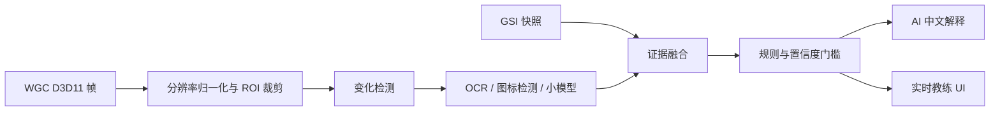

# 游戏画面捕获与 AI 教练可行性

文档版本：2026-08-12

## 结论

Windows 画面捕获可行，但不应替代 GSI。推荐链路是：

`GSI 确定性状态 + Windows.Graphics.Capture 低频画面特征 -> 置信度融合 -> 规则判断 -> AI 解释`

首选 Microsoft `Windows.Graphics.Capture`（WGC），不接入 NVIDIA Capture SDK。NVIDIA 官方已说明 NVFBC 在 Windows 10 及以上弃用，最后支持版本为 Windows 10 1803；当前 Capture SDK 9.0 的新增能力和支持平台是 Linux。NVENC 是编码器，也不能替代画面捕获。

真正的风险不在“能否截图”，而在两个后续问题：

1. 画面识别能否在分辨率、UI 缩放、特效、皮肤、色盲模式和版本变化下保持可验证的准确率。
2. 实时视觉建议是否符合 Valve、赛事和直播平台的现行规则。产品必须保持不读内存、不注入、不 Hook、不模拟输入、不识别玩家本来不可见的信息。

## 高光录屏与合规边界

“从高光录屏分析”不天然比截图合规。合规判断看分析发生的时间和建议是否形成即时决策优势，而不是看输入来自截图、视频文件还是持续写入的录像：

| 方案 | 对局时机 | 风险判断 | 产品建议 |
|---|---|---|---|
| 用户主动导入已经结束的本地高光录像，离线分析 | 赛后 | 最低 | 首个视觉分析功能 |
| 用户明确选择已经结束的录像文件，自动生成报告 | 赛后 | 较低 | 可作为赛后分析增强 |
| 对局中后台持续读取正在写入的高光录像 | 对局中 | 中等偏高 | 仍属于实时视觉辅助，不能用“录像”规避规则 |
| 实时捕获画面并立即生成购买、走位或技能建议 | 对局中 | 最高 | 只有完成 Valve、赛事和平台规则复核后再评估 |

因此首版视觉功能应限定为：用户主动选择本地文件、比赛结束后开始处理、默认不上传原始视频、不自动操作、每条结论附带时间戳和证据片段。对局中的持续捕获即使只使用玩家可见信息，也应当单独按实时辅助工具审查；“不读内存”只能降低技术侵入性，不能自动解决规则问题。

## 方案比较

| 方案 | 适用性 | 优点 | 主要限制 | 决策 |
|---|---|---|---|---|
| Windows.Graphics.Capture | 高 | WinUI 3 可直接接入；按窗口或显示器捕获；帧以 D3D11 surface 提供；支持后台取帧 | 首次需要用户同意；无边框捕获另需 capability 和授权；需处理窗口缩放、HDR、最小化和设备丢失 | 首选 |
| DXGI Desktop Duplication | 中 | Windows 8+；提供 dirty/move rect；适合显示器级低延迟复制 | 面向整个输出而不是单窗口；旋转、鼠标、多显示器和 `DXGI_ERROR_ACCESS_LOST` 都要自行处理；固定 BGRA8，HDR 路径不理想 | 仅兼容回退 |
| NVIDIA Capture SDK / NVFBC | 低 | Linux/NVIDIA 远程桌面场景效率高 | Windows 10+ 已弃用；不能覆盖当前普通 GeForce Windows 用户；增加厂商绑定 | 不采用 |
| GDI/PrintWindow | 低 | 实现简单 | 游戏和硬件加速窗口中经常拿不到稳定帧，性能和颜色路径也不适合持续分析 | 不采用 |

## Microsoft 接入边界

- WGC 的 `GraphicsCapturePicker` 由用户选择 Dota 2 窗口或显示器，并由系统显示捕获提示边框。
- WinUI 3 需要用窗口 HWND 初始化 picker。
- 桌面应用可通过 `IGraphicsCaptureItemInterop::CreateForWindow(HWND)` 绑定指定窗口；最低为 Windows 10 1903。
- `Direct3D11CaptureFramePool` 提供 `Direct3D11CaptureFrame.Surface`。取帧、裁剪和预处理应在后台线程执行，不能在 UI 线程逐帧做重活。
- HDR 屏幕可能需要 `R16G16B16A16_FLOAT` 与 HDR-to-SDR tone mapping，否则颜色会过曝或失真。
- 请求无系统边框捕获需要 `GraphicsCaptureAccessKind.Borderless`、`graphicsCaptureWithoutBorder` capability 和用户授权。第一版不申请该能力，保留系统提示边框。

## 推荐处理管线

实现原则：

- 不按显示器刷新率推理。第一版限制在每秒 1-2 帧，只分析发生变化的 ROI。
- 优先识别稳定区域：顶部比分/计时、击杀提示、装备栏、技能栏和可见的状态图标。
- 小地图只做“可见图标变化”实验，不据此声称敌方真实位置、视野或意图。
- GSI 与 API 是确定性数据时，视觉结果不能覆盖它；视觉只补充 GSI 没有的可见界面证据。
- 每个视觉事件保存 `区域、时间、模型版本、置信度`，默认不落盘原始截图。
- 低置信度、分辨率未知、画面被遮挡或窗口最小化时直接停止视觉建议，不让模型猜测。

## 可先做与不可先做

第一阶段可以验证：

- Dota 2 无边框窗口在 1080p、1440p、4K 下能否稳定获得非黑帧。
- 装备栏和技能栏 ROI 是否能通过模板/小模型稳定识别已知图标与冷却遮罩。
- 击杀提示和系统提示能否用 OCR/分类器提取，并与 GSI 时间对齐。
- 捕获与推理开启后，游戏帧时间、CPU、GPU、NPU、显存和功耗增量。

第一阶段不做：

- 从单帧推断走位好坏、敌方意图、战争迷雾后的状态或技能冷却。
- 自动点击、按键、购买、施法、地图标记或进程内存读取。
- 把视觉模型的低置信度输出直接发送给语言模型生成确定性建议。

## PoC 验收门槛

只有同时满足以下条件才进入产品实现：

1. 1080p、1440p、4K 和 100%/125%/150% UI 缩放都能正确定位 ROI。
2. 连续 30 分钟捕获不黑屏、不持续累积显存，窗口缩放和切换显示器后能恢复。
3. 开启捕获后不造成可感知的游戏帧时间尖峰；性能数据按目标机器实测记录，不能用理论值代替。
4. 图标/OCR 识别按事件类型分别评测；关键提醒必须达到预先定义的精确率，低于门槛时只作为调试信息。
5. 所有建议都能回溯到 GSI evidence 或视觉 evidence；缺少证据时输出“无法判断”。
6. 完成 Valve 当前规则与目标赛事规则复核，确认产品边界后再发布实时视觉功能。

## 实施顺序

1. 先实现独立的 `VideoAnalysisService`，只接受赛后本地视频文件，避免把 D3D 生命周期塞进 `MainWindow`。
2. 增加 ROI 配置与离线 fixture，用高光样本验证识别，不连接实时教练。
3. 再新建独立 `ScreenCaptureService` 接口，设计 WGC 窗口选择、帧池、设备丢失、尺寸变化和停止清理；只输出内存中的时间戳帧。
4. 加入视觉 evidence 模型、置信度门槛和 GSI 时间同步；视觉结果不能覆盖 GSI 的确定性数据。
5. 完成性能、准确率、隐私、Valve/赛事规则复核后，才在设置中暴露实时视觉实验开关。

## 官方资料

- Microsoft: [Screen capture](https://learn.microsoft.com/en-us/windows/apps/develop/media-authoring-processing/screen-capture)
- Microsoft: [IGraphicsCaptureItemInterop::CreateForWindow](https://learn.microsoft.com/en-us/windows/win32/api/windows.graphics.capture.interop/nf-windows-graphics-capture-interop-igraphicscaptureiteminterop-createforwindow)
- Microsoft: [GraphicsCaptureAccess.RequestAccessAsync](https://learn.microsoft.com/en-us/uwp/api/windows.graphics.capture.graphicscaptureaccess.requestaccessasync)
- Microsoft: [Desktop Duplication API](https://learn.microsoft.com/en-us/windows/win32/direct3ddxgi/desktop-dup-api)
- NVIDIA: [NVIDIA Capture SDK](https://developer.nvidia.com/capture-sdk)
