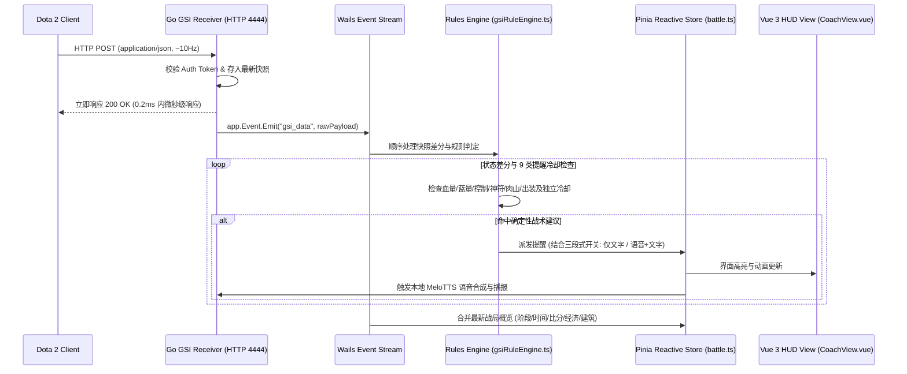
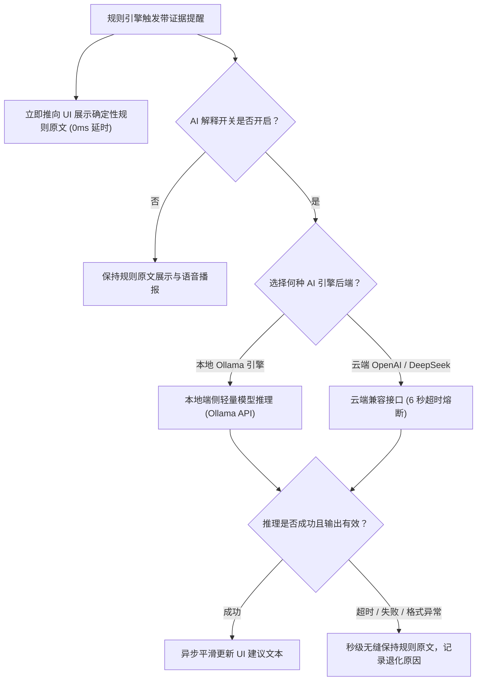
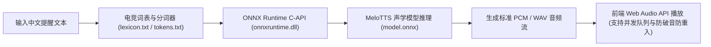
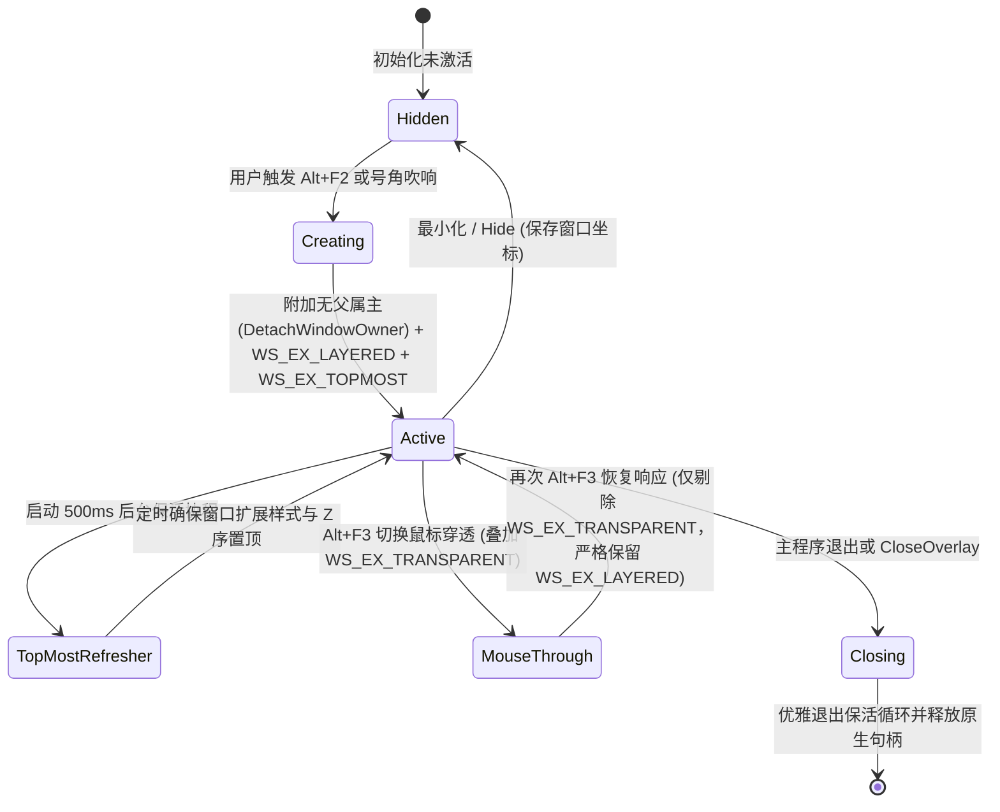

# 神盾教练子系统运行语义与降级机制 (SUBSYSTEM_RUNTIMES.md)

本文档详述神盾教练各核心子系统在运行时的状态流转、因果机制、并发模型与容灾降级规则。

---

## 1. GSI 实时接收与单消费者事件管线

Dota 2 Game State Integration（GSI）是系统获取对局状态的唯一实时通道。

### 关键运行语义：
- **极速应答**：基于 Go 原生 `net/http` 在后台 Goroutine 接收 HTTP POST，在 0.2ms 内返回 200 OK，杜绝影响 Dota 2 客户端网络。
- **单消费者顺序处理**：所有快照由 Go 接收器直接通过 Wails 运行时事件管道派发，前端规则引擎单通道顺序处理，彻底解耦 UI 渲染主线程。
- **断线与心跳管理**：若超过 3 秒未收到新快照，状态自动切换为“已断开连接”，重置瞬态并通知前端展示断线状态。
- **端口自定义与优雅重启**：支持用户在设置中自定义监听端口，配置更新时平滑重启 HTTP Server。

---

## 2. 确定性规则引擎与独立冷却计算

规则引擎负责产生带证据链（Evidence）的确定性提醒，**拥有最终的告警触发裁定权**。

### 规则分类与触发因果链：
| 规则类别 | 判定条件（基于相邻快照差分） | 证据字段 (Evidence) | 默认独立冷却 |
|---|---|---|:---:|
| **生命危急** | 当前生命值百分比 < 30% 且处于存活状态 | `health_percent`, `alive` | 8 秒 |
| **法力耗尽** | 当前法力值百分比 < 20% 且附近有敌方/处于危险 | `mana_percent`, `alive` | 10 秒 |
| **关键大招就绪** | 终极技能从 CoolingDown 变为 Ready | `ability.name`, `ability.cooldown` | 15 秒 |
| **阵亡与买活** | 英雄从存活变为死亡；买活资金充足且战局关键 | `respawn_seconds`, `buyback_cooldown` | 15 秒 |
| **控制锁定** | 自身获得眩晕 (Stunned) / 沉默 (Silenced) / 缠绕 (Rooted) | `is_stunned`, `is_silenced` | 5 秒 |
| **地图战略节点** | 4分钟圣水符 / 6分钟神符刷新前 15 秒；肉山击杀或刷新窗口 | `clock_time`, `roshan_state` | 单次事件 |
| **痛苦魔方倒计时** | 比赛 20 分钟痛苦魔方刷新倒计时 | `clock_time` | 单次事件 |

### 独立冷却（Per-Rule Cooldown）保证：
每条规则拥有独立的计时器，防止某一高频警告（如持续低血）压制其他重要状态（如关键大招转好）。

---

## 3. 实时教练 AI 旁路解释与降级机制

AI 模型在实时教练中**仅充当可选的自然语言短解释器**，绝不参与规则判决。

### 三级降级策略：
1. **三档语音播报滑块**：
   - 档位 0：关闭（静音且不提示）；
   - 档位 1：仅文字播报（界面滚动高亮，不发声）；
   - 档位 2：播报-语音（文字同步 + MeloTTS 纯离线实时合成播报）。
2. **云端 OpenAI 兼容 API**：轻量 HTTP 请求，设置 6 秒超时熔断，避免网络波动挂起。
3. **规则原文兜底（绝对防线）**：任何 AI 异常、网络中断或超时，实时教练界面均正常展示规则引擎原文，GSI 吞吐量 0 损失。

---

## 4. Go 原生离线 MeloTTS 语音子系统

系统采用纯 Go 原生离线 TTS 方案，彻底移除对外部云端服务与大型 Python 环境的依赖：

### 关键运行保障：
- **热身启动**：服务初始化时自动进行 1 次极简音频推理热身（Warmup），消除对局中初次播报的冷启动延迟；
- **并发互斥保护**：内部采用互斥锁保护单次模型推理流水线，避免并发重入造成 ONNX Runtime 崩溃；
- **发音纠错**：内置电竞专用词表（如“大晕锤”、“黑皇杖”、“跳刀”、“圣剑”等），确保英雄与物品术语发音准确标准。

---

## 5. 独立悬浮窗生命周期与 Win32 原生置顶保活机制

局内经济悬浮窗具备独立顶级窗口与透明置顶能力：

### 关键语义与防死锁设计：
- **无父属主 (Independent Top-Level)**：通过 `DetachWindowOwner` 清空 `GWLP_HWNDPARENT`，主窗口最小化或聚焦切换时，悬浮窗绝不会跟随隐藏或改变 Z 序；
- **WS_EX_LAYERED 永久保留**：无论穿透开启还是关闭，始终保留 `WS_EX_LAYERED`，杜绝透明背景变为黑底；
- **防重入锁设计**：`attachWindowHooksLocked` 与 `attachWindowHooks` 严格隔离持锁与非持锁上下文，彻底杜绝重入死锁；
- **安全原子销毁**：`CloseOverlay` 采用先加锁快照置空指针、后执行系统销毁的两阶段语义，避免与窗口事件回调产生竞态死锁。

---

## 6. GSI 配置文件自动安装机制

Dota 2 需在指定目录加载 GSI 配置文件：
- 路径格式：`[Steam安装路径]/steamapps/common/dota 2 beta/game/dota/cfg/gamestate_integration/gamestate_integration_aegis.cfg`
- 服务端口：`http://127.0.0.1:4444/`（或自定义配置端口）
- 缓冲区与心跳：`buffer` 设为 `0.1`，`heartbeat` 设为 `30.0`
- 数据订阅节点：`provider`、`map`、`player`、`hero`、`abilities`、`items`、`buildings`。
