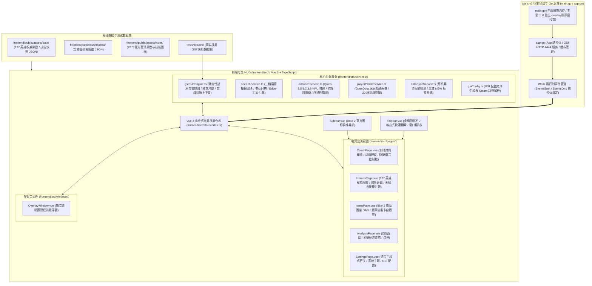

# 神盾教练系统全景图谱与工程分层契约 (SYSTEM_LANDSCAPE.md)

本文档定义神盾教练（AegisCoach）当前系统的整体架构全景、技术栈选型、工程分层边界与依赖规则。

---

## 1. 架构拓扑全景

神盾教练采用 **Wails v3 桌面宿主 + Go 后端服务 + Vue 3 / TypeScript 前端电竞 HUD** 现代化极轻架构：

---

## 2. 技术栈与选型矩阵

| 维度 | 选型与版本 | 决策考量与优势 |
|---|---|---|
| **桌面宿主与后端** | Wails v3 + Go 1.27+ | 纯 Go 静态编译 |
| **实时网络服务** | Go 原生 `net/http` | 后台 Goroutine 极轻量监听本机 4444 端口接收 Dota 2 GSI，微秒级响应 200 OK |
| **前端视图框架** | Vue 3 (SFC `<script setup lang="ts">`) + TypeScript | 现代化组件化开发，强类型约束，Composition API 响应式机制天然适配电竞 HUD 高频状态合并 |
| **构建与样式** | Vite 8 + TailwindCSS v4 | 原生 ESM 毫秒级热重载，全新高性能样式引擎，生产包体积精简极致 |
| **状态管理** | Vue 3 Reactive Store (`reactive`) | 极轻量原生响应式状态，避免冗余状态库开销，支持跨组件订阅与事件派发 |
| **图标与视觉** | Dota 2 原生官方图标 + @lucide/vue | 100% 游戏原生视觉风格，高对比度防眩光电竞暗色主题 |

---

## 3. 代码物理与逻辑分层契约

| 目录层级 | 所属职责 | 依赖与调用规则 |
|---|---|---|
| **`frontend/src/types/`** | 前端强类型契约模型 (英雄、物品、GSI、告警) | 纯 TypeScript 接口定义，全仓统一导入 |
| **`frontend/src/data/`** | 127 英雄中文常数映射表、出装指南、提醒分类 | 静态常数兜底，提供断网与无网络零延时秒查 |
| **`frontend/src/utils/`** | 1 级基础属性计算公式、技能宏解析、HTML 标签清洗 | 纯函数工具库，严格贴合 Dota 2 官方公式与机制 |
| **`frontend/src/services/`** | GSI 规则裁定引擎、语音播报服务、配置管理 | 战术规则判定（带冷却链）、电竞 TTS 合成与 GSI 安装向导 |
| **`frontend/src/store/`** | Vue 3 响应式全局状态机与战局上下文 | 管理实时战局、配置项、多窗口通信与告警流水线 |
| **`frontend/src/components/`** | 物理隔离 TitleBar、Sidebar、三段式开关与业务卡片 | 纯视图组件，严格解耦与受控 |
| **`frontend/src/pages/`** | 各业务独立主视图页面 | 负责主窗口核心内容渲染与交互 |
| **`frontend/src/windows/`** | 独立透明置顶悬浮窗 (`OverlayWindow.vue`) | `-overlay` 启动参数独立运行，极简无边框轻量渲染 |
| **`app.go` / `main.go`** | Go 宿主入口、HTTP 接收器与原生桌面管理 | 负责 GSI 监听、缓存目录管理、多窗口生命周期管控与 Wails 运行时桥接 |

---

## 4. 架构红线约束

1. **绝对合规红线**：严禁读取游戏内存、注入 DLL、Hook 渲染或模拟键鼠操作；仅通过 Dota 2 官方 HTTP GSI 接口获取实时快照。
2. **前后端职责分离**：Go 负责高频网络接收、本地系统服务与多窗口托管，前端负责电竞 HUD 视图渲染与战术规则裁定，严格保持模块分层。
3. **确定性规则优先**：战术告警由确定性规则决定，AI 仅充当可选旁路短解释，任何模型超时或异常必须无缝展示规则原文。
4. **全仓 CRLF 换行符**：所有文本文件严格使用 Windows CRLF (`\r\n`)，杜绝混入 Unix LF。
