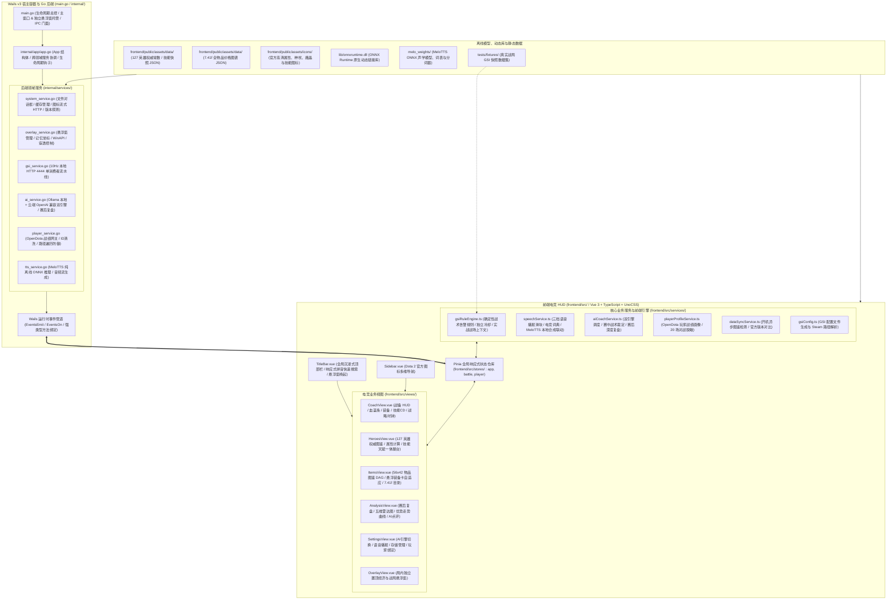

# 神盾教练系统全景图谱与工程分层契约 (SYSTEM_LANDSCAPE.md)

本文档定义神盾教练（AegisCoach）当前系统的整体架构全景、技术栈选型、工程分层边界与依赖规则。

---

## 1. 架构拓扑全景

神盾教练采用 **Wails v3 桌面宿主 + Go 后端领域服务 + Vue 3 / TypeScript 前端电竞 HUD** 现代化极轻架构：

---

## 2. 技术栈与选型矩阵

| 维度 | 选型与版本 | 决策考量与优势 |
|---|---|---|
| **桌面宿主与后端** | Wails v3 + Go 1.23+ / 1.27+ | 纯 Go 高性能静态编译，资源消耗极低，便携单可执行文件 |
| **实时网络服务** | Go 原生 `net/http` | 后台 Goroutine 极轻量监听本机 4444 端口接收 Dota 2 GSI，微秒级响应 200 OK |
| **本地语音合成** | MeloTTS (ONNX Runtime C-API) | 纯 Go 本地调用 `lib/onnxruntime.dll`，0 网络消耗、0 外部 Python 依赖，毫秒级流式语音输出 |
| **前端视图框架** | Vue 3 (SFC `<script setup lang="ts">`) + TypeScript | Composition API 响应式机制天然适配电竞 HUD 高频状态合并与强类型校验 |
| **构建与样式** | Vite 6+ + UnoCSS | 原生 ESM 毫秒级热重载，原子化 CSS 按需编译，电竞暗黑专属设计规范与调色板 |
| **状态管理** | Pinia (`app`, `battle`, `player`) | 强类型响应式状态中心，模块化解耦，严守单向数据流与数据单一事实来源原则 |
| **图标与视觉** | Dota 2 原生官方图标 + @lucide/vue | 100% 游戏官方视觉风格，高对比度防眩光电竞暗色主题 |
| **Win32 原生集成** | Windows API (user32.dll) | 悬浮窗独立顶级窗口化 (`DetachWindowOwner`)、`WS_EX_LAYERED` 分层透明保护与 `WS_EX_TRANSPARENT` 穿透 |

---

## 3. 代码物理与逻辑分层契约

| 目录层级 | 所属职责 | 依赖与调用规则 |
|---|---|---|
| **`internal/app/`** | 跨模块服务协调、Wails 生命周期总门面 | 聚合各个 Domain Services，注入 Wails 宿主 |
| **`internal/services/`** | 后端业务服务（系统、AI、TTS、GSI、悬浮窗、玩家） | 各自高内聚处理原生与业务逻辑，遵循防重入锁与并发安全 |
| **`internal/models/`** | 前后端强类型 DTO 契约与序列化定义 | 统一数据契约，严格脱敏敏感凭据 |
| **`internal/overlay/`** | Win32 API 悬浮窗置顶保活与样式扩展 | 纯底层系统调用，通过原子样式与置顶保活协程运行 |
| **`frontend/src/api/`** | 前端强类型 IPC 门面与后端调用封装 | **只负责调用后端并返回结果**，严禁在 API 层内做状态持久化或二次调用 |
| **`frontend/src/stores/`** | Pinia 全局状态管理中枢 | 负责全局状态维护与持久化（如 settings 读写、GSI 战况存储） |
| **`frontend/src/views/`** | 核心业务主视图及其子组件库 | 负责界面渲染与人机交互，通过 Store 订阅数据并展示 Toast |
| **`frontend/src/services/`** | 纯前端 GSI 规则引擎、AI 客户端、语音播报控制 | 战术规则判定（带冷却链）、电竞 TTS 合成与 GSI 安装向导 |
| **`frontend/src/data/`** | 127 英雄中文常数映射表、出装指南、7.41f 物品图谱 | 静态权威常数兜底，提供断网与无网络零延时秒查 |
| **`frontend/src/utils/`** | 1 级基础属性计算公式、技能宏解析、HTML 标签清洗 | 纯函数工具库，严格贴合 Dota 2 官方公式与机制 |

---

## 4. 架构红线约束

1. **绝对合规红线**：严禁读取游戏内存、注入 DLL、Hook 渲染或模拟键鼠操作；仅通过 Dota 2 官方 HTTP GSI 接口获取实时快照。
2. **前后端职责分离**：Go 负责高频网络接收、本地系统服务、语音模型推理与多窗口托管；前端负责电竞 HUD 视图渲染与战术规则裁定，严格保持模块分层。
3. **确定性规则优先**：战术告警由确定性规则决定，AI 仅充当可选旁路短解释，任何模型超时或异常必须无缝展示规则原文。
4. **零伪造原则**：实时教练、战况看板与悬浮窗严禁在未建立真实对局连接时伪造任何虚拟英雄；未获取到官方版本时置空，杜绝硬编码伪造版本号。
5. **全仓 CRLF 换行符**：所有文本文件严格使用 Windows CRLF (`\r\n`)，杜绝混入 Unix LF。
