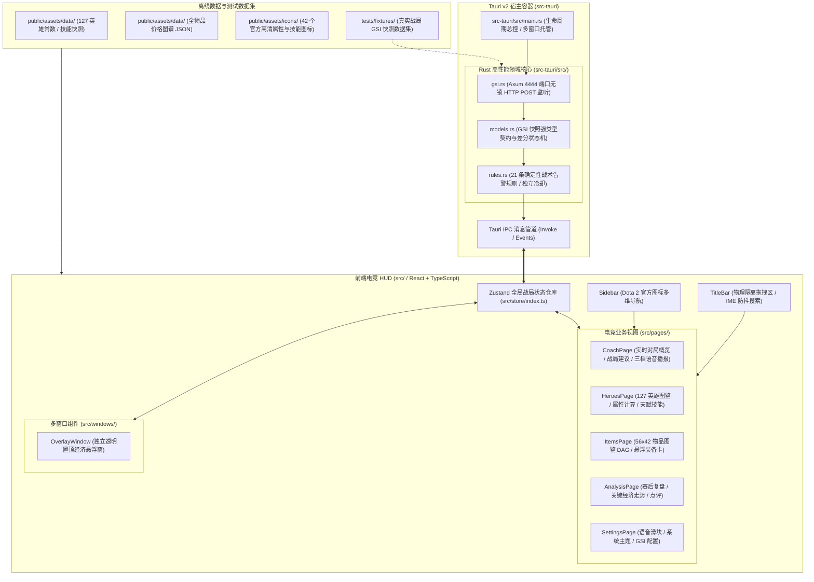

# 神盾教练系统全景图谱与工程分层契约 (SYSTEM_LANDSCAPE.md)

本文档定义神盾教练（AegisCoach）当前系统的整体架构全景、技术栈选型、工程分层边界与依赖规则。

---

## 1. 架构拓扑全景

神盾教练采用 **Tauri v2 桌面宿主 + TypeScript 前端电竞 HUD + Rust 高性能无锁领域核心** 现代化极轻架构：

---

## 2. 技术栈与选型矩阵

| 维度 | 选型与版本 | 决策考量与优势 |
|---|---|---|
| **桌面宿主与后端** | Tauri v2 + Rust 2021 | 跨平台轻量宿主，直接复用系统 WebView2，便携二进制仅 ~10MB 级别，无 .NET/Electron 运行时膨胀 |
| **实时网络服务** | Axum 0.7+ (Tokio 异步运行时) | 监听本机 4444 端口接收 Dota 2 GSI，吞吐量超万 QPS，零垃圾回收卡顿 |
| **前端视图框架** | React 18 + TypeScript 5.7+ | 现代化组件化架构，严格强类型约束，毫秒级响应 |
| **构建与样式** | Vite 6 + TailwindCSS 3.4 | 原生 ESM 毫秒级热重载，CSS 原生按需构建，生产包体积仅 ~200KB |
| **状态管理** | Zustand 5.0 | 极简响应式状态，支持多组件订阅、轻量跨窗口消息驱动 |
| **图标与视觉** | Dota 2 原生官方图标 + Lucide React | 100% 游戏原生视觉风格，高对比度防眩光电竞暗色主题 |

---

## 3. 代码物理与逻辑分层契约

| 目录层级 | 所属职责 | 依赖与调用规则 |
|---|---|---|
| **`src/types/`** | 前端强类型契约模型 (英雄、物品、GSI、告警) | 纯 TypeScript 接口定义，全仓统一导入 |
| **`src/data/`** | 127 英雄中文常数映射表、拼音别名库 | 静态常数兜底，提供断网与无网络零延时秒查 |
| **`src/utils/`** | 1 级基础属性计算公式、技能分类与占位符补值 | 纯函数工具库，严格贴合 Dota 2 官方公式与机制 |
| **`src/store/`** | Zustand 全局状态机与战局上下文 | 管理实时战局、配置项、多窗口通信与告警流水线 |
| **`src/components/`** | 物理隔离 TitleBar、Sidebar 与通用业务卡片 | 纯视图组件，严格受控与解耦 |
| **`src/pages/`** | 各业务独立主视图页面 | 负责主窗口内容渲染 |
| **`src/windows/`** | 独立透明置顶悬浮窗 | 独立路由 (`?window=overlay`)，极简无边框轻量渲染 |
| **`src-tauri/src/`** | Rust 本地 HTTP 服务与确定性规则判定 | 高性能网络 I/O 与规则差分，向前端派发状态事件 |

---

## 4. 架构红线约束

1. **绝对合规红线**：严禁读取游戏内存、注入 DLL、Hook 渲染或模拟键鼠操作；仅通过 Dota 2 官方 HTTP GSI 接口获取实时快照。
2. **前后端职责分离**：Rust 负责高频 I/O 与确定性规则裁定，前端负责电竞 HUD 视图渲染与状态展现，严格保持模块分层。
3. **确定性规则优先**：战术告警由 21 条确定性规则决定，AI 仅充当可选旁路短解释，任何模型超时或异常必须无缝展示规则原文。
4. **全仓 CRLF 换行符**：所有文本文件严格使用 Windows CRLF (`\r\n`)，杜绝混入 Unix LF。
